# HDXBoxeR

HDX-MS is a high-information-content method. It is both a curse and a
blessing. A lot can be learned, but data analysis is tedious, as each
experiment in HDX-MS provides information on hundreds of peptides. Each
experiment should be done at least in triplicate. Very often, multiple
time points for each protein state are performed. Finally, multiple
protein states are compared, as the goal of performing HDX-MS is often
to compare how ligand binding or mutation affects the wild-type apo
protein state. This can easily lead to a dataset with multiple thousand
peptides that need to be matched between the sets compared and deemed
statistically relevant or not. HDXBoxeR provides a statistical framework
to identify peptides that are significantly different between given
protein states. HDXBoxeR automatically matches and compares sets with
each other. It calculates if one protein state is different from another
using Welch’s T-test and the Critical Interval statistical framework
(Hageman and Weis; Anal. Chem. 2019, 91, 13, 8008–8016). It allows for
fast data export and generates scripts for Pymol. Finally, it returns
all the calculations required for publication, as recommended by Masson
et al. in Nature Methods volume 16, pages 595–602 (2019).

HDXBoxeR facilitates multiple aspects of HDX data analysis:

1.  Reprocesses data to the format required for data publication.
2.  Calculates parameters for a general HDX summary table, such as
    backexchange, peptide lengths, and statistical information required
    for data publication.
3.  Converts the output from HDXExaminer (Sierra Analytics, now Trajan
    Scientific) to a format that is easier to handle and analyze.
4.  Using Welch T-tests, it identifies peptides that are significantly
    different between the sets.
5.  Generates scripts for Pymol.
6.  Facilitates easy plot generation, including heat maps, robot plot
    (modified butterfly plot), significant peptides, volcano plots, and
    average deuteration.
7.  Generates inputs for ExtReme. The package allows for comparison
    between different protein states and facilitates the discrimination
    of peptides that are significantly different between the sets.

## How to use this vignette?

The vignette is divided into several sections that introduce different
aspects of analysis:

1.  Input Preparation: Learn how to prepare inputs for HDXBoxeR in
    HDXExaminer.
2.  Installation: Get started and set up the necessary components.
3.  Inputs Reprocessing: Understand how to prepare inputs to be usable
    in R.
4.  Statistical Analysis: Explore which peptides are significant.
5.  Plots Generation: Visualize the peptides deemed significant.
6.  Pymol Scripts Generation: Create scripts listing significant
    peptides and residues.
7.  Data Summary: Obtain general information about the dataset.
8.  Save Data: Save data in the reprocessed format.
9.  ExtReme Outputs Generation: Automatically prepare input for bimodal
    analysis.
10. Proposed Workflow: A section for those in a hurry.

#### Beyond this vignette

This vignette covers the two-state workflow. Other topics have their own
vignettes:

| Topic | Functions | Vignette |
|----|----|----|
| Load DynamX or other software; replicates; FD normalization | [`read_hdx()`](https://mkajano.github.io/HDXBoxeR/reference/read_hdx.md), [`as_hdx_long()`](https://mkajano.github.io/HDXBoxeR/reference/as_hdx_long.md), `output_tp(percent = "FD")` | [`vignette("input_formats")`](https://mkajano.github.io/HDXBoxeR/articles/input_formats.md) |
| Coverage, redundancy, back-exchange, peptide checks | [`general_info()`](https://mkajano.github.io/HDXBoxeR/reference/general_info.md), [`plot_peptide_coverage_map()`](https://mkajano.github.io/HDXBoxeR/reference/plot_peptide_coverage_map.md), [`peptide_qc()`](https://mkajano.github.io/HDXBoxeR/reference/peptide_qc.md) | [`vignette("data_quality")`](https://mkajano.github.io/HDXBoxeR/articles/data_quality.md) |
| Two states, peptide by peptide | [`plot_fissure_vent()`](https://mkajano.github.io/HDXBoxeR/reference/plot_fissure_vent.md) | [`vignette("fissure_vent")`](https://mkajano.github.io/HDXBoxeR/articles/fissure_vent.md) |
| Three or more states, regions, time courses | [`compare_states_tp()`](https://mkajano.github.io/HDXBoxeR/reference/compare_states_tp.md), [`compare_regions()`](https://mkajano.github.io/HDXBoxeR/reference/compare_regions.md), [`compare_timecourse()`](https://mkajano.github.io/HDXBoxeR/reference/compare_timecourse.md), [`residue_regions()`](https://mkajano.github.io/HDXBoxeR/reference/residue_regions.md) | [`vignette("multistate")`](https://mkajano.github.io/HDXBoxeR/articles/multistate.md) |
| Interactive plots | [`interactive_fissure_explorer()`](https://mkajano.github.io/HDXBoxeR/reference/interactive_fissure_explorer.md) | [`vignette("interactive_explorer")`](https://mkajano.github.io/HDXBoxeR/articles/interactive_explorer.md) |
| Structures | [`plot_hdx_structure()`](https://mkajano.github.io/HDXBoxeR/reference/plot_hdx_structure.md), `pymol_script_*()` | [`vignette("hdx_structure")`](https://mkajano.github.io/HDXBoxeR/articles/hdx_structure.md) |
| Tables for a paper, HTML report | [`hdx_summary_table()`](https://mkajano.github.io/HDXBoxeR/reference/hdx_summary_table.md), [`hdx_results_table()`](https://mkajano.github.io/HDXBoxeR/reference/hdx_results_table.md), [`render_report()`](https://mkajano.github.io/HDXBoxeR/reference/render_report.md) | sections 7-8 below |

All functions use the same significance test: Welch p-value below
`pvalue` and difference above the critical interval. `p_adjust = "BH"`
corrects the p-values for multiple testing.

### 1. Input preparation

The HDXBoxeR requires data! The package can be tested using the data
included as a reference and example with the package, so don’t worry.
However, to be able to perform your analysis, you need to import your
data into R. Input for the HDXBoxeR should be generated using
HDXExaminer from Sierra Scientifics.

#### Input preparation

Input preparation: 1. Open your HDexaminer file. 2. Under the Peptides
tab \> Pool \> right-click peptide: delete peptides with no usable data.
3. Tools \> Options \> Display \> Deuteration Table: Display all columns
(we did not select show low-confidence results). 4. Tools \> Export \>
All results table.

HDXBoxeR significantly facilitates the comparison of multiple Protein
States in the time series and the number of replicates. We recommend
using at least 3 replicates for a robust statistical analysis. Protein
States can have different numbers of replicates (for example 3 and 4).
Another recommendation is to use only peptides the user is confident in.
There is no point in analyzing bad data.

The example looks as follows:

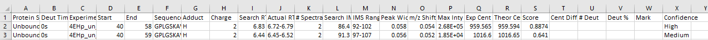

The input file should have the following columns: Protein State, Deut
Time, Experiment, Start, End, Sequence, Charge, Search RT, \# Deut, Deut
%. If any of these columns is missing data will not be loaded. Another
thing to make sure of is that the columns are properly aligned, meaning
there is the name number of headers and columns, as sometimes the
Confidence column gets shifted in the AllResultsTable.csv file. We keep
typically just peptides with high and medium confidence. Example data
compares two Protein States: Unbound and Bound. Each of the sets has
three replicates. Data also should have one replicate of undeuterated
and fully deuterated sets labeled as 0s and FD respectively for allowing
full analysis.

### 2. Installation & Loading

First, ensure that you have R and RStudio installed on your computer.
Then you can proceed with the installation of the HDXBoxeR package.
There are two methods to install the HDXBoxeR package:

1.  CRAN

To install, use the following command:

``` r

####installation using CRAN
install.packages("HDXBoxeR") #execute only once
```

2.  GitHub

The HDXBoxeR package is available on GitHub and can be installed using
the devtools package. This method of installation is an alternative to
the CRAN method.

``` r

####installation using Github. 
#run only if devtools package is not installed on your machine
install.packages("devtools") 

library(devtools) #run next two commends only once
devtools::install_github("mkajano/HDXBoxeR")

#Once installed, you can load the HDXBoxeR package using the following command:
library(HDXBoxeR)
```

### 3. How to load data into R

To load data into R, you will need input as described in section 1.
Example input is provided as a reference, and to start the fun. Data,
when loaded, will be reprocessed into different formats depending on the
type of analysis to be performed. There are several options in which
input can be processed, as listed below. Function names reflect the
chosen option.

Input can be formatted to:

- Analyze time points *or* time courses analysis (`output_tp` vs
  `output_tc` functions).
- Analyze Deuterons Uptake *or* Percent Deuteration (flag
  `percent=F/T`).
- Use all protein states/deuteration times *or* use selected (options:
  `states` and `times`, respectively).
- Use all replicates *or* specify the maximum number of replicates
  (`replicates` option in the function).
- Match peptides by sequence between protein states *or* by position
  only (flag `seq_match`). Default is to match sequences, to prevent
  mismatches. Use `seq_match=TRUE` for point mutants.

Examples:

``` r

# Path to example input
library(HDXBoxeR)
file_nm<-system.file("extdata", "All_results_table.csv", package = "HDXBoxeR") 
### Later change the path to the path you your data!!!

##########Deuteration uptake vs percent deuteration file preparation
#### Input for uptake deuteration. Default will use all common states, all common Deuteration Times, all replicates of each state, no csv will be written, and peptide sequences will be matched.
input_uptake_timepoint<-output_tp(filepath = file_nm) 
#> Protein.States used: Unbound bound
#> Deut.times used: 3.00s 60.00s 1800.00s 72000.00s
#> 29 peptide row(s) dropped: 29 not measured in every state, 0 with fewer than 2 replicate value(s)
#> Number of replicates used: Unbound=3 bound=3
#> no csv file written
# input for percent deuteration
input_deut_timepoint<-output_tp(filepath = file_nm, percent=T) 
#> Protein.States used: Unbound bound
#> Deut.times used: 3.00s 60.00s 1800.00s 72000.00s
#> 29 peptide row(s) dropped: 29 not measured in every state, 0 with fewer than 2 replicate value(s)
#> Number of replicates used: Unbound=3 bound=3
#> no csv file written

#################
####Time courses 
#Deuteration uptake
input_uptake_timecourse<-output_tc(file_nm) 
#> Protein.States used: Unbound bound
#> Deut.times used: 3.00s 60.00s 1800.00s 72000.00s
#> 1 peptide row(s) dropped: 1 not measured in every time point, 0 with fewer than 2 replicate value(s)
#> Number of replicates used: 3.00s=3 60.00s=3 1800.00s=3 72000.00s=3
#> no csv file written
# Time courses comparisons
input_deut_timecourse<-output_tc(file_nm, percent=T)
#> Protein.States used: Unbound bound
#> Deut.times used: 3.00s 60.00s 1800.00s 72000.00s
#> 1 peptide row(s) dropped: 1 not measured in every time point, 0 with fewer than 2 replicate value(s)
#> Number of replicates used: 3.00s=3 60.00s=3 1800.00s=3 72000.00s=3
#> no csv file written

#################
####Analyze selected protein.states, deuteration times, replicates. 
names_states<- nm_states(file_nm) ## returns names of the states in file.
input_two_states_two_timepoints<-output_tp(filepath=file_nm, replicates=3, states=names_states[c(1,2)], times=c("3.00s", "72000.00s"),  percent=FALSE)
#> 14 peptide row(s) dropped: 14 not measured in every state, 0 with fewer than 2 replicate value(s)
#> Number of replicates used: Unbound=3 bound=3
#> no csv file written
###add option to match sequence and to save as csv (here not used)
input_subset_states<-output_tp(filepath=file_nm, replicates=3, states=names_states[2], times=c("3.00s", "72000.00s"), percent=FALSE, seq_match=FALSE, csv="NA")
#> Number of replicates used: bound=3
#> no csv file written
```

#### Residue-level values

HDX-MS measures peptides. Two functions estimate values per residue
instead:

- [`residue_level_average()`](https://mkajano.github.io/HDXBoxeR/reference/residue_level_average.md):
  each residue gets the average of all peptides covering it. Short
  peptides count more.
- [`residue_deconvolution()`](https://mkajano.github.io/HDXBoxeR/reference/residue_deconvolution.md):
  uses the differences between overlapping peptides to separate the
  residues. It resolves boundaries between regions better than the
  average.

``` r

## needs uptake in Da (percent = FALSE)
input_uptake_timepoint <- output_tp(filepath = file_nm, percent = FALSE)
#> Protein.States used: Unbound bound
#> Deut.times used: 3.00s 60.00s 1800.00s 72000.00s
#> 29 peptide row(s) dropped: 29 not measured in every state, 0 with fewer than 2 replicate value(s)
#> Number of replicates used: Unbound=3 bound=3
#> no csv file written
residue_deconv <- residue_deconvolution(input_uptake_timepoint, protein_length = 225)

## needs percent deuteration (percent = TRUE)
residue_avg <- residue_level_average(input_deut_timepoint, protein_length = 225)
```

`lambda_smooth` in
[`residue_deconvolution()`](https://mkajano.github.io/HDXBoxeR/reference/residue_deconvolution.md)
makes neighboring residues more similar. The default is 0.1. On the
example data, values between 0 and 1 predicted left-out peptides equally
well.

**Now that the data is loaded let’s start the fun!**

### 4. Statistical Analysis

Great! Now that the hardest part is done, let’s delve into the actual
analysis.

**HDXBoxeR provides a statistical framework to identify peptides that
are significantly different between given protein states.** To conduct
statistics, we recommend providing at least 3 replicates for each
protein state (duplicate data also work). **Only Deut Times present in
all Protein States are used. All replicates are used, and states may
have different numbers of replicates.**

#### Some theoretical details about statistical analysis

HDXBoxeR employs a hybrid statistical approach using the Welch T-test
and Critical interval statistical framework proposed by Hageman and Weis
(Hageman and Weis; Anal. Chem. 2019, 91, 13, 8008–8016). To be deemed
significantly different, peptides must meet significance criteria on
both the individual peptide level (Welch T-test) and surpass the global
critical interval for all peptides in the set.

For detailed information, please refer to the cited paper (Hageman and
Weis; Anal. Chem. 2019, 91, 13, 8008–8016). In short, the Welch T-test
determines if the Null hypothesis can be rejected (Null hypothesis: the
average of two means for individual peptides are equal). If the
individual critical interval was below the p-value, the null hypothesis
was rejected – peptides were deemed significant from an individual
peptide standpoint. For the global significance threshold, the
propagated standard error of the pooled standard deviation of means for
all peptides in two sets was calculated and scaled to the Student
distribution. This involves calculating the pooled standard deviation
for two sets separately, propagating the error overall standard
deviation of these two sets, and finally, scaling it by T-distribution
to determine the global critical interval that is the global threshold.
If the peptides passed both criteria for the whole set and individual
peptides, they were deemed significant.

**[`plot_fissure_vent()`](https://mkajano.github.io/HDXBoxeR/reference/plot_fissure_vent.md)
shows this same hybrid criterion geometrically** - state1 vs state2
deuteration plotted directly (no delta column), with the global critical
interval drawn as bands parallel to the diagonal and each peptide’s own
Welch test drawn as an ellipse calibrated so that touching the diagonal
itself means that peptide’s own p-value did not clear the cutoff. See
[`vignette("fissure_vent")`](https://mkajano.github.io/HDXBoxeR/articles/fissure_vent.md)
for the full explanation and worked examples.

#### Practical Tips for Statistical Analysis in HDXBoxeR

Most of the statistical analysis is already implemented in plot and
other functions, but it is good to have a way to do it yourself if
needed. HDXBoxeR allows for the facile calculation of averages and the
standard deviation for each set. Additionally, it allows for the
calculation of global and individual critical intervals.

**Individual p-values for each peptide are calculated against the first
protein state based on the location from the input file. If the user
desires calculation against different protein states, it can be done by
loading HDXExaminer, taking advantage of the `states` parameter in
[`output_tp()`](https://mkajano.github.io/HDXBoxeR/reference/output_tp.md)
or
[`output_tc()`](https://mkajano.github.io/HDXBoxeR/reference/output_tc.md)
functions.**

``` r

library(HDXBoxeR)
file_nm<-system.file("extdata", "All_results_table.csv", package = "HDXBoxeR") 
input_uptake_timepoint<-output_tp(filepath = file_nm) 
#> Protein.States used: Unbound bound
#> Deut.times used: 3.00s 60.00s 1800.00s 72000.00s
#> 29 peptide row(s) dropped: 29 not measured in every state, 0 with fewer than 2 replicate value(s)
#> Number of replicates used: Unbound=3 bound=3
#> no csv file written


###average calculation for all peptides
av1<-ave_timepoint(input_uptake_timepoint)
head(av1)
#>   Deut.Time Start End             Sequence Search.RT Charge av_Unbound_X..Deut
#> 1     3.00s    40  58  GPLGSKAVVPGPAEHPLQY      6.83      2           8.327667
#> 2     3.00s    40  59 GPLGSKAVVPGPAEHPLQYN      6.44      2           8.717333
#> 3     3.00s    47  63    VVPGPAEHPLQYNYTFW     10.86      2           3.974667
#> 4     3.00s    62  77     FWYSRRTPGRPTSSQS      6.12      3           7.820667
#> 5     3.00s    63  77      WYSRRTPGRPTSSQS      5.33      3           7.625333
#> 6     3.00s    64  77       YSRRTPGRPTSSQS      4.64      2           7.799333
#>   av_bound_X..Deut
#> 1         7.013667
#> 2         7.468667
#> 3         2.785667
#> 4         7.779333
#> 5         7.788667
#> 6         7.635333
###average differences (against first Protein State in the file)
da1<-dif_ave(av1)

###standard deviation calculation for all peptides
sd1<-sd_timepoint(input_uptake_timepoint)
head(sd1)
#>   Deut.Time Start End             Sequence Search.RT Charge sd_Unbound_X..Deut
#> 1     3.00s    40  58  GPLGSKAVVPGPAEHPLQY      6.83      2         0.13838473
#> 2     3.00s    40  59 GPLGSKAVVPGPAEHPLQYN      6.44      2         0.15430597
#> 3     3.00s    47  63    VVPGPAEHPLQYNYTFW     10.86      2         0.10868456
#> 4     3.00s    62  77     FWYSRRTPGRPTSSQS      6.12      3         0.13059990
#> 5     3.00s    63  77      WYSRRTPGRPTSSQS      5.33      3         0.22095324
#> 6     3.00s    64  77       YSRRTPGRPTSSQS      4.64      2         0.05689757
#>   sd_bound_X..Deut
#> 1       0.05379901
#> 2       0.10442382
#> 3       0.04764801
#> 4       0.08114391
#> 5       0.01357694
#> 6       0.03754109

### Global critical interval for 1 protein sets
CI_single(s1 =sd1[,7], replicates = 3 , alpha=0.01)
#> [1] 0.1789317
##Global critical interval for 2 protein sets
CI_2pts(s1 = sd1[,7], s2=sd1[,8], replicates = 3, alpha=0.01)
#> [1] 0.2706825

##individual peptide p-value calculation against first set in the input file
pv1<-pv_timepoint(input_uptake_timepoint)
head(pv1)
#>   Deut.Time Start End             Sequence Search.RT Charge pv_Unbound_X..Deut
#> 1     3.00s    40  58  GPLGSKAVVPGPAEHPLQY      6.83      2                  1
#> 2     3.00s    40  59 GPLGSKAVVPGPAEHPLQYN      6.44      2                  1
#> 3     3.00s    47  63    VVPGPAEHPLQYNYTFW     10.86      2                  1
#> 4     3.00s    62  77     FWYSRRTPGRPTSSQS      6.12      3                  1
#> 5     3.00s    63  77      WYSRRTPGRPTSSQS      5.33      3                  1
#> 6     3.00s    64  77       YSRRTPGRPTSSQS      4.64      2                  1
#>   pv_bound_X..Deut
#> 1     0.0012982057
#> 2     0.0006305205
#> 3     0.0006958101
#> 4     0.6701607913
#> 5     0.3287217910
#> 6     0.0188970633


####Analyze selected protein.states, deuteration times, replicates. 
names_states<- nm_states(file_nm) ## returns names of the states in file.
### choosing different state as a control for analysis
input_states_reversed<-output_tp(file_nm, states=names_states[c(2,1)] )
#> Deut.times used: 3.00s 60.00s 1800.00s 72000.00s
#> 29 peptide row(s) dropped: 29 not measured in every state, 0 with fewer than 2 replicate value(s)
#> Number of replicates used: bound=3 Unbound=3
#> no csv file written
pv2<-pv_timepoint(input_states_reversed)
head(pv2)
#>   Deut.Time Start End             Sequence Search.RT Charge pv_bound_X..Deut
#> 1     3.00s    40  58  GPLGSKAVVPGPAEHPLQY      6.83      2                1
#> 2     3.00s    40  59 GPLGSKAVVPGPAEHPLQYN      6.44      2                1
#> 3     3.00s    47  63    VVPGPAEHPLQYNYTFW     10.86      2                1
#> 4     3.00s    62  77     FWYSRRTPGRPTSSQS      6.12      3                1
#> 5     3.00s    63  77      WYSRRTPGRPTSSQS      5.33      3                1
#> 6     3.00s    64  77       YSRRTPGRPTSSQS      4.64      2                1
#>   pv_Unbound_X..Deut
#> 1       0.0012982057
#> 2       0.0006305205
#> 3       0.0006958101
#> 4       0.6701607913
#> 5       0.3287217910
#> 6       0.0188970633
```

#### States, Replicates, Timepoints, etc.

There are a few variables that are going to be useful while analyzing
the data. It might be a good idea to have them saved in the memory. One
can call them as follows:

``` r

###load data

states<-arguments_call1(filepath=file_nm)
times<-arguments_call2(filepath=file_nm, states=states)
replicates<-arguments_call3(filepath=file_nm, states=states, times=times)
```

#### Sub-setting of the Input Table

Sometimes, we do not want to work on or plot the whole imported dataset.
One can either load a smaller subset or choose a part of the subset from
the loaded dataset to work on. The already loaded data can be subsetted
using the `select_indices` function or by choosing desired columns from
the loaded data. In the loaded data, the first 6 columns always describe
peptides, and the rest of the columns contain data.

``` r


#################
####Time courses 
#Deuteration uptake
input_uptake_timecourse<-output_tc(file_nm) 
#> Protein.States used: Unbound bound
#> Deut.times used: 3.00s 60.00s 1800.00s 72000.00s
#> 1 peptide row(s) dropped: 1 not measured in every time point, 0 with fewer than 2 replicate value(s)
#> Number of replicates used: 3.00s=3 60.00s=3 1800.00s=3 72000.00s=3
#> no csv file written
# Time courses comparisons

small_df1<-input_uptake_timepoint[,c(1:6, 10:12)]

#if one wants to focus just on the few first peptides in the data it is possible to select a few rows from the input data. 
small_df2<-input_uptake_timepoint[1:3,]

#To have more control of the selecting one can also use the select_indices functions as follows:
##for output_tp function variables that can be used are:
#below one time of 60s was used for peptides that started at residue 50, ended at residue 100 and  at the max 12 residues long. 
#not all parameters need to be used.
inda<-select_indices(input_uptake_timepoint,  times = c("60.00s"),start = 50, end=100, length=12)

#after the indices are selected the input can be subsetted as normal

small_df3<-input_uptake_timepoint[inda,]

##for the output_tc function allowed are the following parameters
timecourse_output<-output_tc(file_nm) 
#> Protein.States used: Unbound bound
#> Deut.times used: 3.00s 60.00s 1800.00s 72000.00s
#> 1 peptide row(s) dropped: 1 not measured in every time point, 0 with fewer than 2 replicate value(s)
#> Number of replicates used: 3.00s=3 60.00s=3 1800.00s=3 72000.00s=3
#> no csv file written
indb<-select_indices(timecourse_output,  states = "bound",start = 50, end=100, length=12)

head(timecourse_output[indb,1:6])
#>       Sequence Protein.State Start End Search.RT Charge
#> 16 YEQNIKQIGTF         bound    78  88      7.61      2
#> 18     IKQIGTF         bound    82  88      6.81      2
#> 20   ASVEQFWRF         bound    89  97     10.72      2
```

### 5. Plots

HDXBoxeR features functionality to create various types of plots,
including volcano plots, heat maps, and robot plots (modified butterfly
plots).

**Information on how to load input into HDXBoxeR can be found in section
3.** If the returned plots have truncated labels, adjust the figure
sizes.

#### Uptake Plots

Sometimes, it is just useful to look at raw-ish data. Uptake plots are
the answer here.

``` r

###load data
library(HDXBoxeR)
file_nm<-system.file("extdata", "All_results_table.csv", package = "HDXBoxeR") 
input_deut_timepoint<-output_tc(file_nm, percent=TRUE) 
#> Protein.States used: Unbound bound
#> Deut.times used: 3.00s 60.00s 1800.00s 72000.00s
#> 1 peptide row(s) dropped: 1 not measured in every time point, 0 with fewer than 2 replicate value(s)
#> Number of replicates used: 3.00s=3 60.00s=3 1800.00s=3 72000.00s=3
#> no csv file written

# define the timepoint using in the experiment. Here the times in seconds
x<-c(3, 60,1800, 72000)
uptake_plots(input_deut_timepoint[1:2,],x)
```

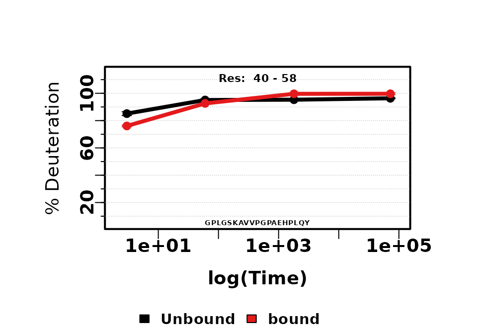

#### Boxplots

Boxplots enable quick comparisons of average uptake or percent
deuteration for all protein states.

``` r

###load data
# library(HDXBoxeR)
# file_nm<-system.file("extdata", "All_results_table.csv", package = "HDXBoxeR") 
# input_uptake_timepoint<-output_tp(file_nm) 


### Returns boxplots for all the time points and all protein states. 
boxplot_tp(input_uptake_timepoint, col= c("gold2", "dodgerblue"))
```

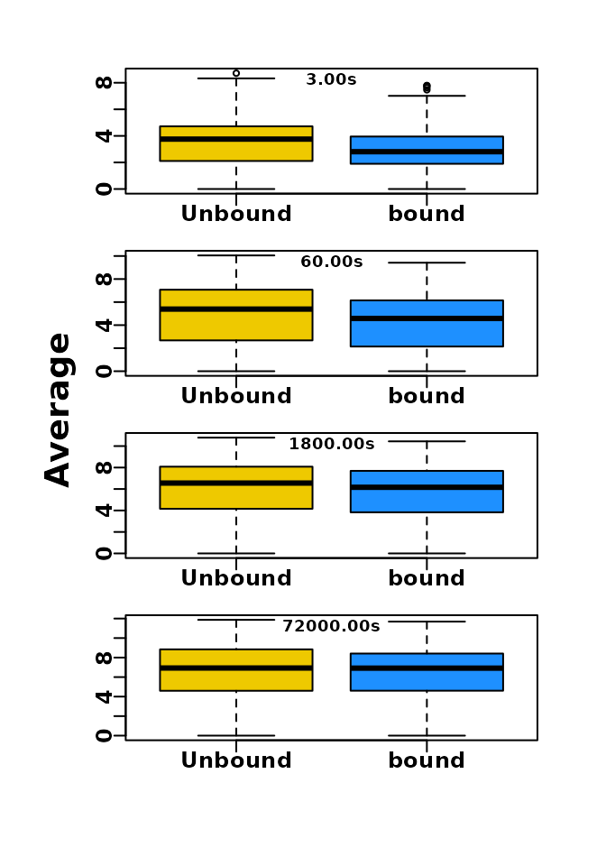

#### Average uptake and procent deuteration plots per time-point

``` r

###load data
library(HDXBoxeR)
file_nm<-system.file("extdata", "All_results_table.csv", package = "HDXBoxeR") 
# ## input for deuteration uptakeinput_uptake_timepoint<-output_tp(file_nm) 
# # input for procent deuteration
input_deut_timepoint<-output_tp(file_nm, percent=T) 
#> Protein.States used: Unbound bound
#> Deut.times used: 3.00s 60.00s 1800.00s 72000.00s
#> 29 peptide row(s) dropped: 29 not measured in every state, 0 with fewer than 2 replicate value(s)
#> Number of replicates used: Unbound=3 bound=3
#> no csv file written

## deuteration uptake for time points
plots_av_tp(input_uptake_timepoint)
```

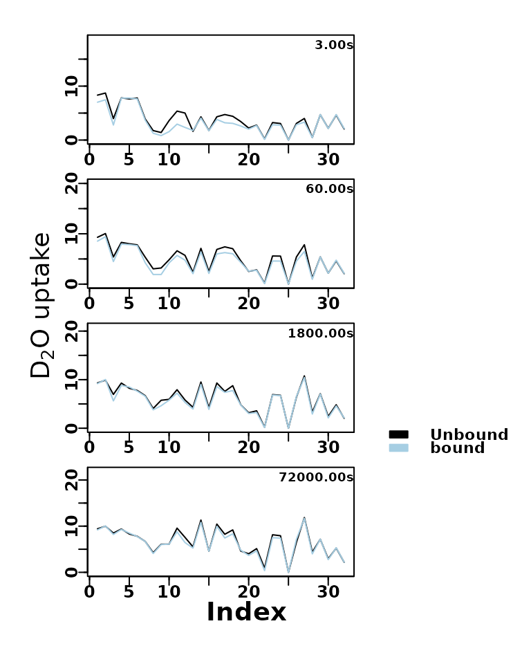

``` r

### average plots with colors chosen by user. 
plots_av_tp(input_uptake_timepoint,replicates=3, col=c(1:10))
```

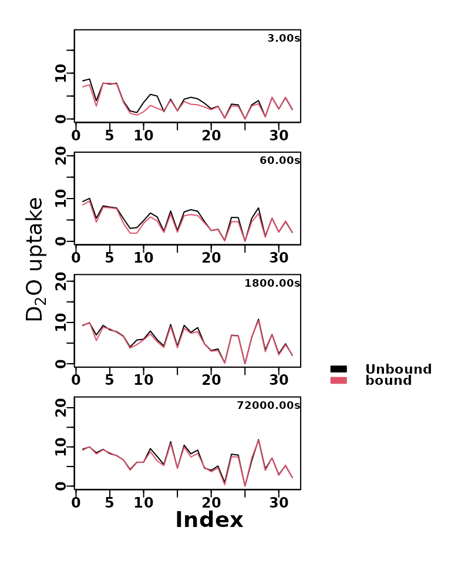

``` r

### average percent deuteration
plots_av_tp_proc(input_deut_timepoint)
```

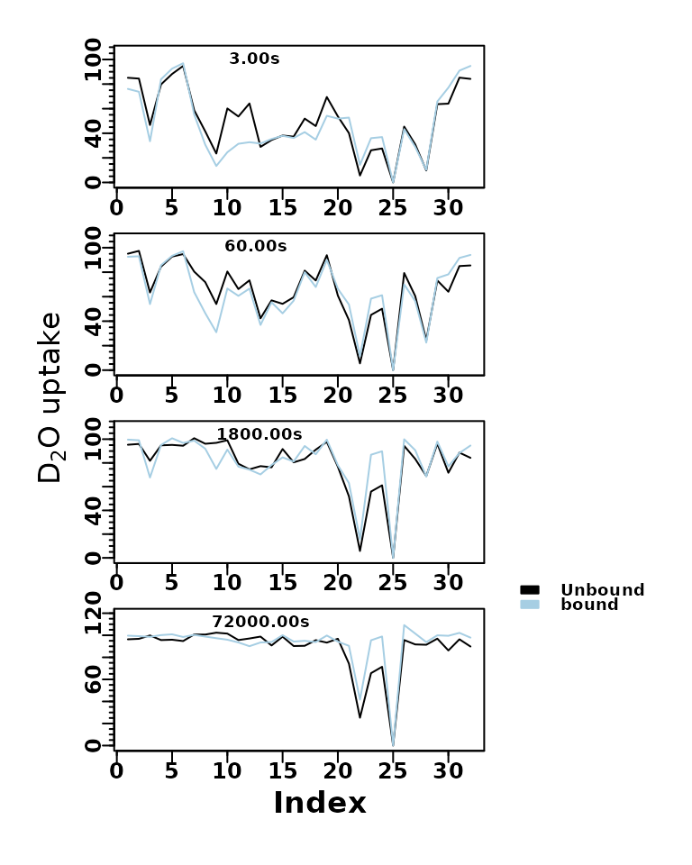

#### Difference Uptake or Percent Deuteration Plots per Time-point

The average difference plots depict deuteration uptake (or percent
deuteration) between different Protein states. By default, the first
Protein State from the input file is chosen as a state from which other
values are subtracted. For example, if the input file has three Protein
States: State1, State2, State2, average difference plots will show two
curves for the difference in deuteration uptake: (1) State1-State2, (2)
State1-State3. If other permutations are desired, use the `states`
parameter in `output_tp` or `output_tc` functions. All time-points are
drawn on separate plots. The function is useful when comparing multiple
Protein States.

``` r

# ###load data
# file_nm<-system.file("extdata", "All_results_table.csv", package = "HDXBoxeR") 
# ## input for deuteration uptake
# input_uptake_timepoint<-output_tp(file_nm) 


## difference in uptake deuterations between two sets
plots_diff_tp(input_uptake_timepoint)
```

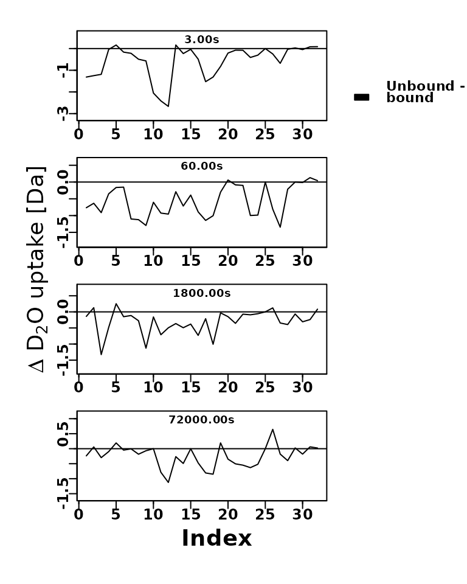

``` r


#Load deut data
# input for procent deuteration
# input_deut_timepoint<-output_tp(file_nm, percent=T) 

### difference in procent deuteration
plots_diff_tp_proc(input_deut_timepoint,replicates=3, col=4)
```

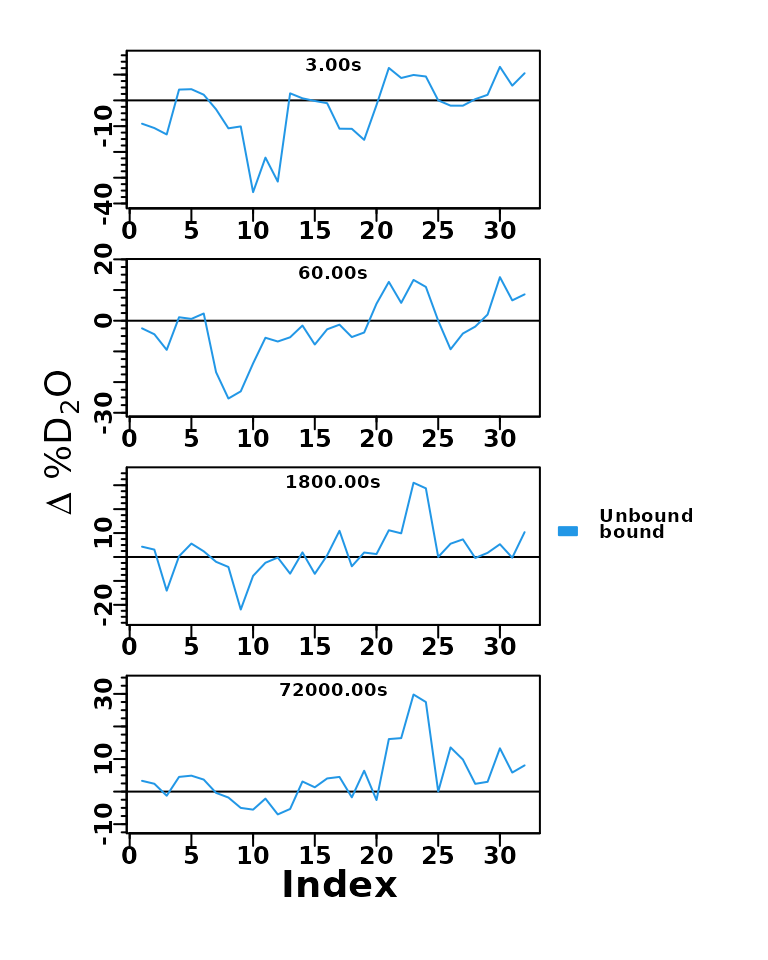

``` r


#input with different order states
names_states<- nm_states(file_nm)
input_reversed_states<-output_tp(file_nm, states = rev(names_states))
#> Deut.times used: 3.00s 60.00s 1800.00s 72000.00s
#> 29 peptide row(s) dropped: 29 not measured in every state, 0 with fewer than 2 replicate value(s)
#> Number of replicates used: bound=3 Unbound=3
#> no csv file written
### average plots for deuteration uptake where control state was chosen differently
plots_diff_tp(input_reversed_states, col="darkgreen")
```

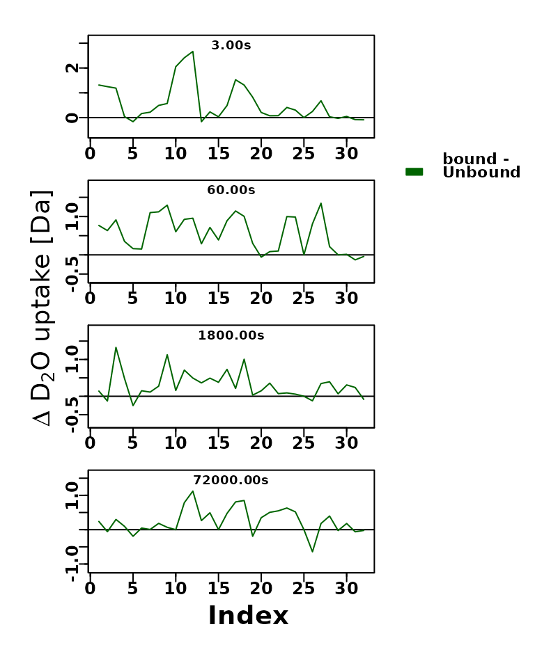

#### Volcano Plots

Volcano plots were introduced by the Weis laboratory (Analytical
Chemistry 2019, 91 (13), 8008-8016 DOI: 10.1021/acs.analchem.9b01325).
The strength of the volcano plots is that they allow for a quick view to
see how many peptides are between the sets and provide statistics for
the differences. The Volcano plots take advantage of the p-value and
critical interval calculation. The p-value is calculated per each
peptide using the Welch t-test for the desired number of replicates. The
global critical interval is calculated as described in Hageman and Weis
(Analytical Chemistry 2019, 91 (13), 8008-8016 DOI:
10.1021/acs.analchem.9b01325). The default alpha is 0.01. The p-value
cut off is marked by horizontal lines, and the global critical interval
by vertical lines. Significantly different peptides between the sets are
located in the shaded area. The volcano plots are only prepared for
differences in deuterons uptake. The critical intervals for all
time-points are returned in the terminal.

``` r

###load data
file_nm<-system.file("extdata", "All_results_table.csv", package = "HDXBoxeR") 
## input for deuteration uptake
a<-output_tp(file_nm) 
#> Protein.States used: Unbound bound
#> Deut.times used: 3.00s 60.00s 1800.00s 72000.00s
#> 29 peptide row(s) dropped: 29 not measured in every state, 0 with fewer than 2 replicate value(s)
#> Number of replicates used: Unbound=3 bound=3
#> no csv file written

### basic volcano plot
plots_vol_tp(a)
#> CI @ 3.00s : 0.35
#> CI @ 60.00s : 0.27
#> CI @ 1800.00s : 0.24
#> CI @ 72000.00s : 0.2
```

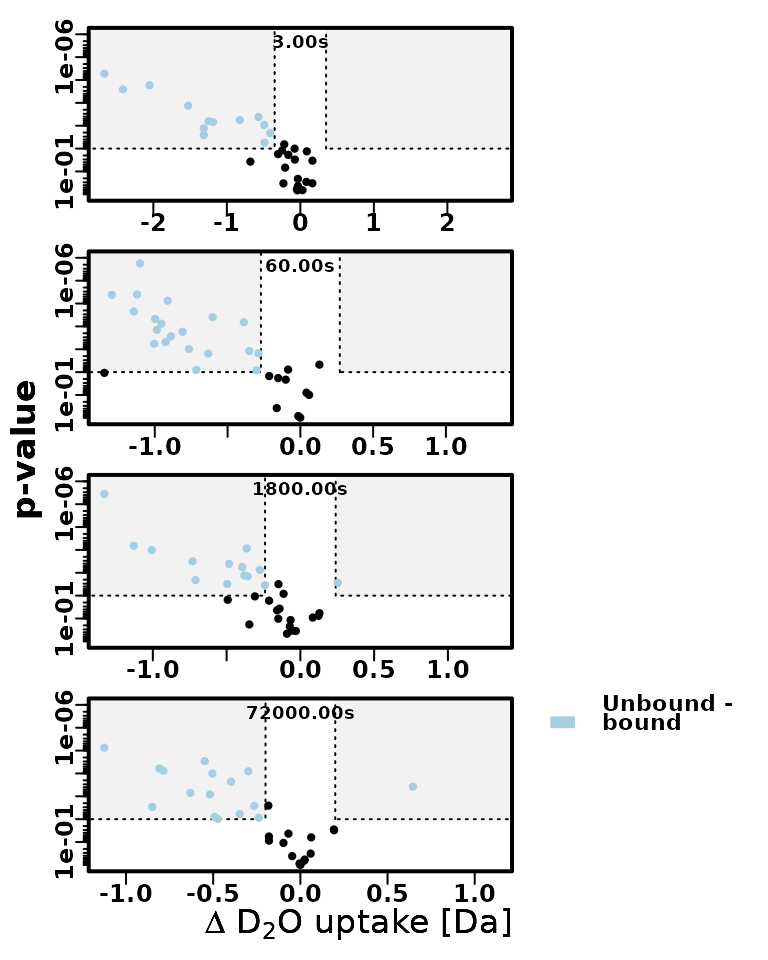

``` r

# change colors for significant peptides in volcano plots
plots_vol_tp(a, col=c(2,3), replicates=3)
#> CI @ 3.00s : 0.35
#> CI @ 60.00s : 0.27
#> CI @ 1800.00s : 0.24
#> CI @ 72000.00s : 0.2
```

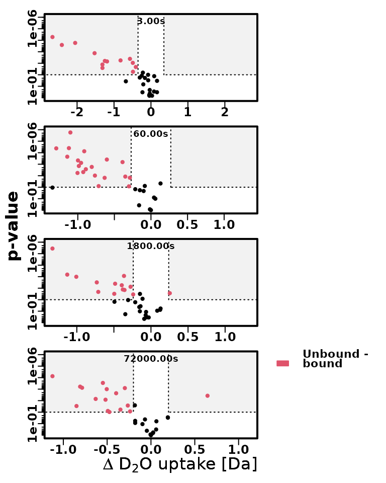

``` r

#change the p-value cutoff from 0.01 to 0.1
plots_vol_tp(a, pvalue = 0.1)
#> CI @ 3.00s : 0.35
#> CI @ 60.00s : 0.27
#> CI @ 1800.00s : 0.24
#> CI @ 72000.00s : 0.2
```

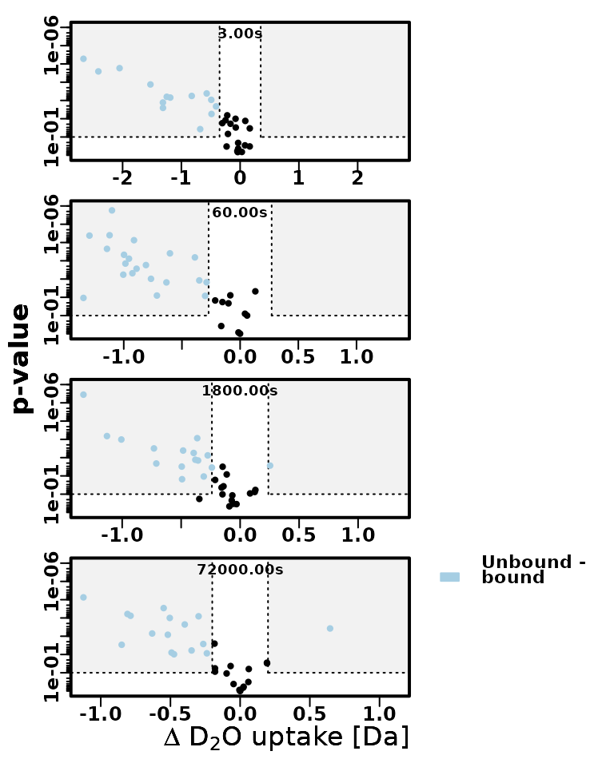

#### Significant Peptides Mapped Along Residue Sequence

The significant peptides plots draw peptides along the covered sequence
of the protein. Peptides deemed significantly different using the Welch
test and the global critical interval criterion are colored in a
red-blue scheme. Red-colored peptides are more exposed compared to the
control set, while blue colors correspond to increased protection
compared to the control set. Non-significant peptides are colored black.

The plots can be drawn using either percent deuteration or deuteration
uptake input sets. If the percent deuteration input is used, the
difference between the two sets is colored according to the chosen
scheme (function `plot_peptide_sig_tp_proc`). If using deuteration
uptake input, data is converted to percents using the equation:
`(Uptake(state1) - Uptake(state2)) / Uptake(state1) * 100%` (function:
`plot_peptide_sig_tp`).

Percent differences are divided into ranges, each corresponding to a
specific color in the red-blue color scheme. Range values can be changed
as desired within the red-blue color scheme. In the terminal, ranges for
each set are returned to help choose ranges of the color scheme.

Plots are generated separately for each time-point and each pair of the
difference values (State1-State2, State1-State3…). The
`plot_peptide_sig_tp` generates multiple plots, which usually calls for
using the plotting parameter `mfrow`.

``` r

###load data
file_nm<-system.file("extdata", "All_results_table.csv", package = "HDXBoxeR") 
## input for deuteration uptake
a<-output_tp(file_nm) 
#> Protein.States used: Unbound bound
#> Deut.times used: 3.00s 60.00s 1800.00s 72000.00s
#> 29 peptide row(s) dropped: 29 not measured in every state, 0 with fewer than 2 replicate value(s)
#> Number of replicates used: Unbound=3 bound=3
#> no csv file written

### significantly different peptides are colored in red-blue scheme. 

#par(mfrow=c(4,1))  # uncomment if desired
plot_peptide_sig_tp(a,replicates = 3) 
#> For timepoint 3.00s
#> values range from  0 to 5.68 %
#> Unbound bound range 0 5.68
```

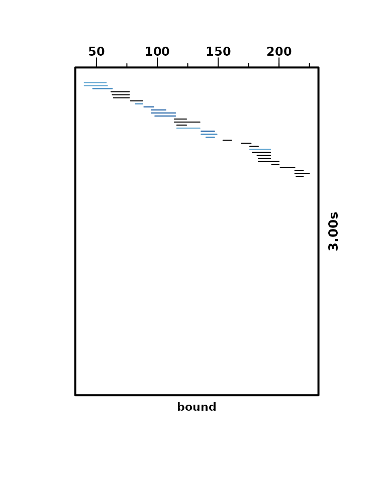

    #> For timepoint 60.00s
    #> values range from  0 to 4.04 %
    #> Unbound bound range 0 4.04

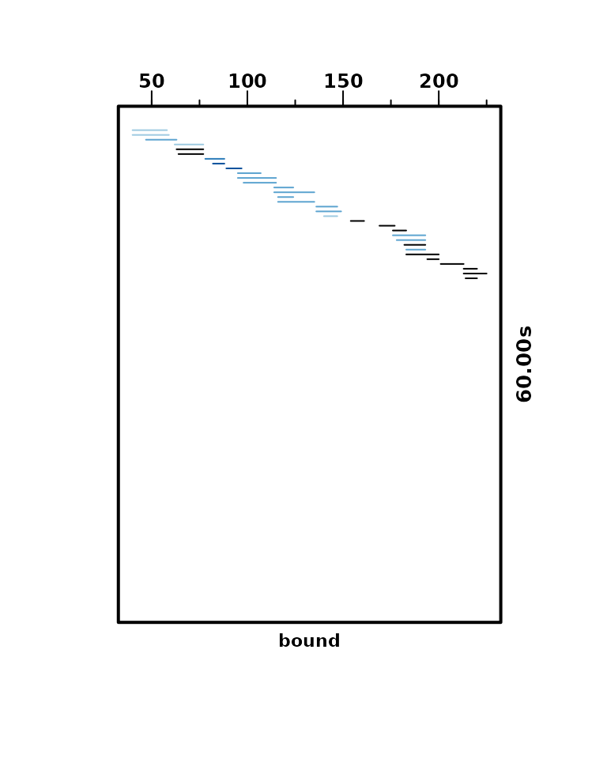

    #> For timepoint 1800.00s
    #> values range from  -0.31 to 1.96 %
    #> Unbound bound range -0.31 1.96

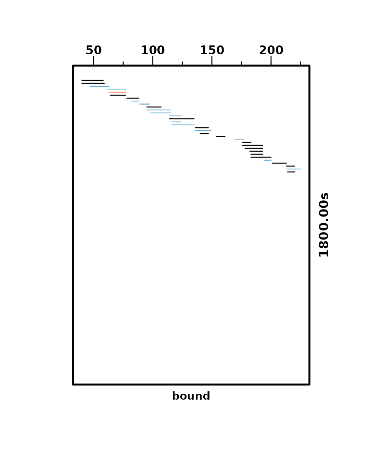

    #> For timepoint 72000.00s
    #> values range from  -0.99 to 6.01 %
    #> Unbound bound range -0.99 6.01

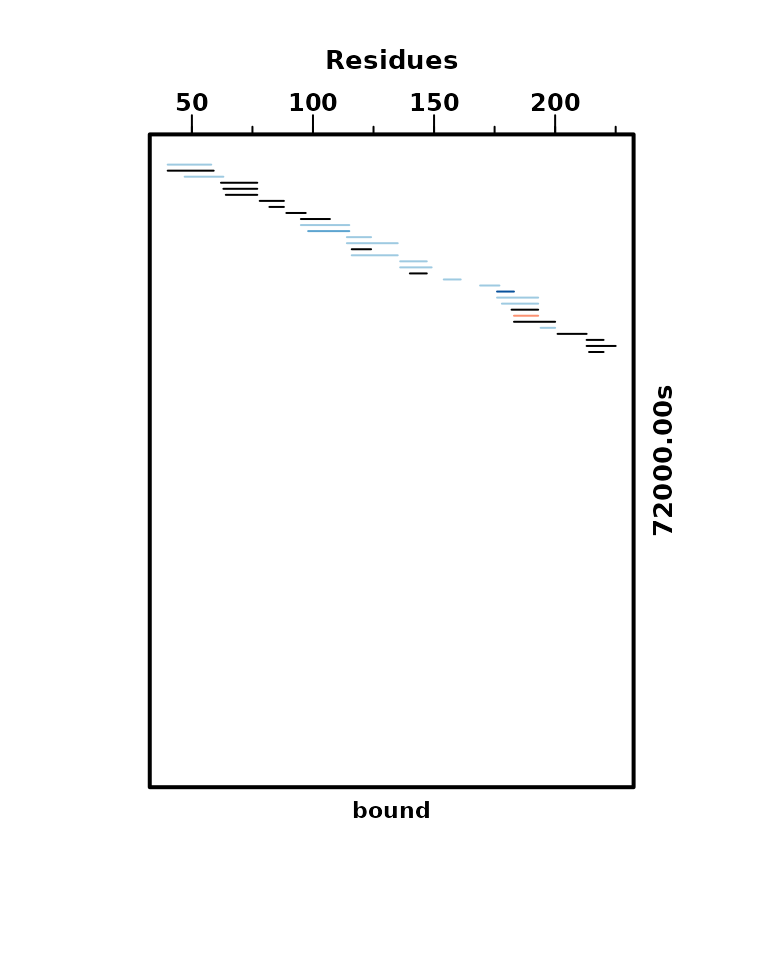

``` r


### Plot where 18 peptides per row are drawn (nb_pep_row=18, default=50), 
#p-value&critial interval was made more stingent (0.001)
# % ranges are colored were changed. 
#par(mfrow=c(4,1)) #uncomment if desired
plot_peptide_sig_tp(a,nb_pep_row = 18, ranges = c(-Inf, -10, -2.5,0,2.5, 10, Inf), pvalue = 0.001) 
#> For timepoint 3.00s
#> values range from  0 to 5.68 %
#> Unbound bound range 0 5.68
```

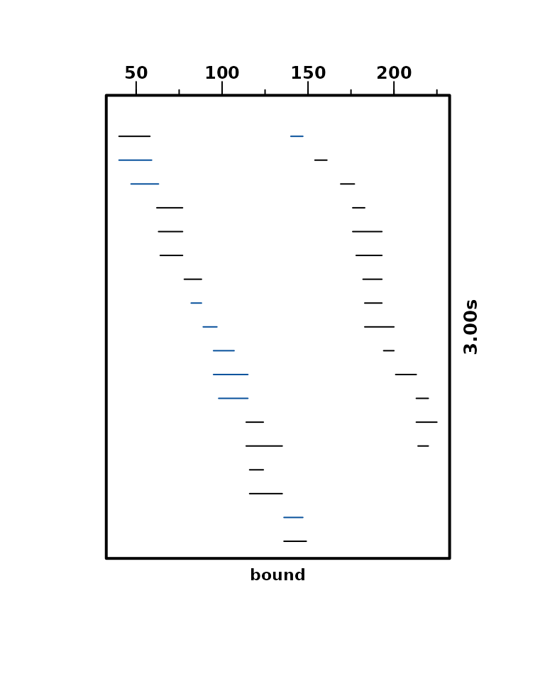

    #> For timepoint 60.00s
    #> values range from  0 to 4.04 %
    #> Unbound bound range 0 4.04

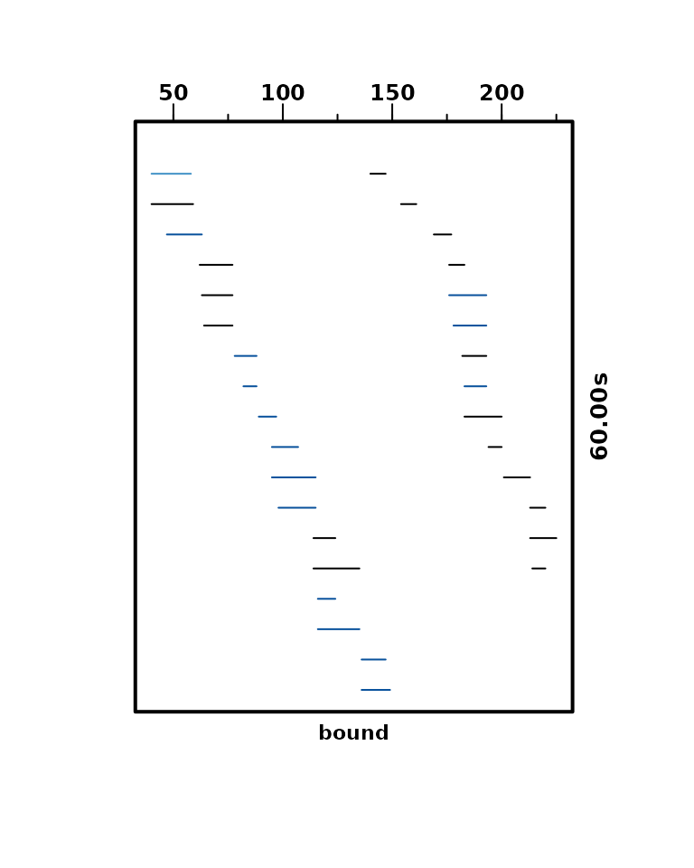

    #> For timepoint 1800.00s
    #> values range from  0 to 1.96 %
    #> Unbound bound range 0 1.96

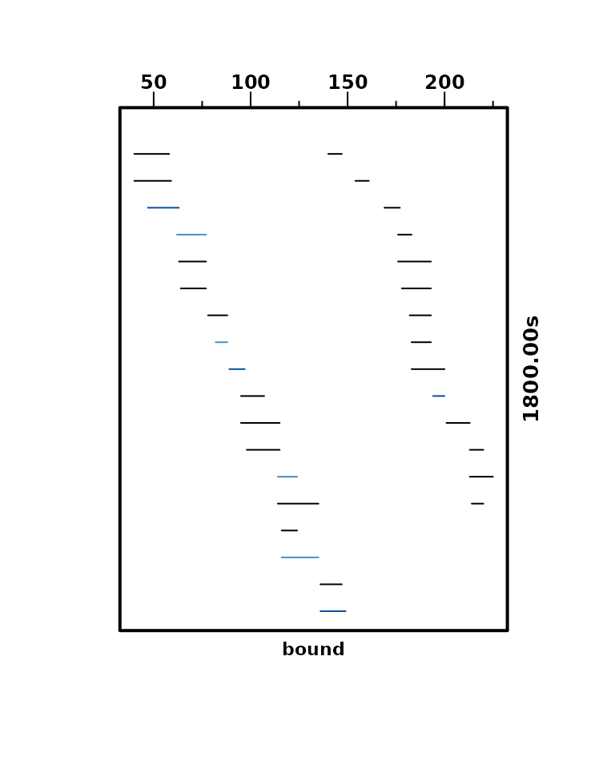

    #> For timepoint 72000.00s
    #> values range from  -0.99 to 6.01 %
    #> Unbound bound range -0.99 6.01

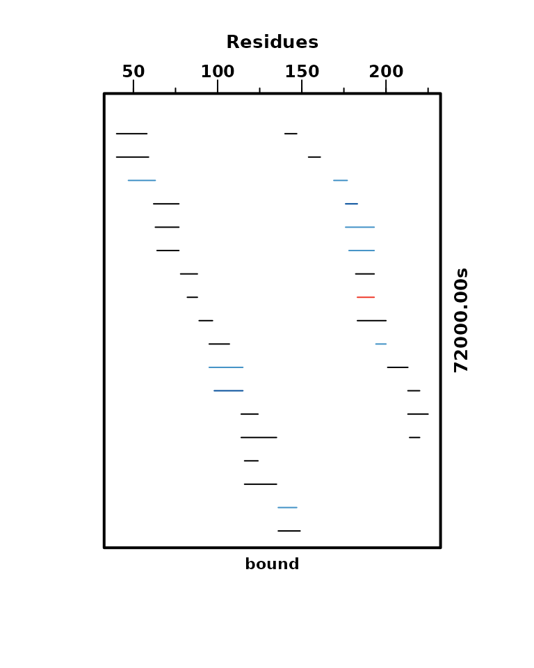

``` r

## Legend for significant peptides plot
#default ranges for figures does not require argument
legend_sig_peptides()
```

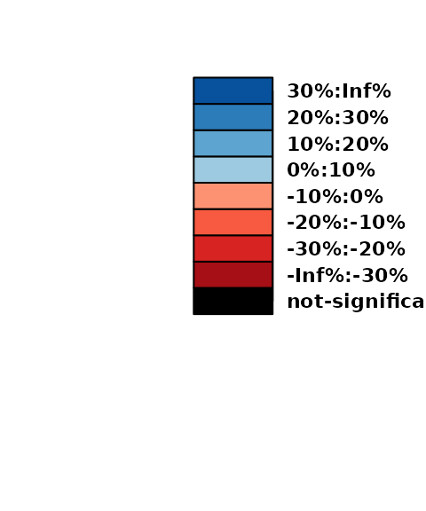

``` r

### Using different range scheme
legend_sig_peptides(ranges = c(-Inf, -10, -2.5,0,2.5, 10, Inf))
```

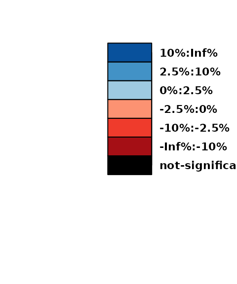

#### Differential heat maps

Differential Heat Maps are plots where peptides significantly different
between the sets are translated into residue-specific information. Heat
maps are a fast, highly informative, and elegant way to see which
regions are perturbed in the sets. However, it means that some
information is lost (coverage). There are two options on how these
calculations are performed:

1.  Average uptake of all significant peptides containing that residue
    is calculated.
2.  Maximum uptake value from all peptides classified as significant
    with that residue in its sequence.

Differential heat maps can be calculated using the difference in percent
deuteration between two sets or uptake of (control - other sets) /
(uptake of control) \* 100.

The example scheme for how average uptake and maximum uptake per residue
are generated is shown below.

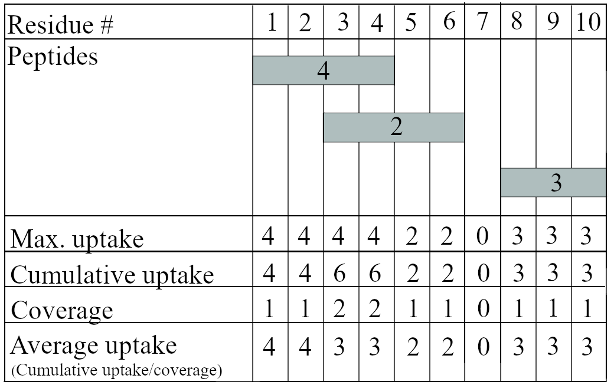

``` r

###load data
library(HDXBoxeR)
file_nm<-system.file("extdata", "All_results_table.csv", package = "HDXBoxeR") 
## input for deuteration uptake
a<-output_tp(file_nm) 
#> Protein.States used: Unbound bound
#> Deut.times used: 3.00s 60.00s 1800.00s 72000.00s
#> 29 peptide row(s) dropped: 29 not measured in every state, 0 with fewer than 2 replicate value(s)
#> Number of replicates used: Unbound=3 bound=3
#> no csv file written
# input for procent deuteration
b<-output_tp(file_nm, percent=T) 
#> Protein.States used: Unbound bound
#> Deut.times used: 3.00s 60.00s 1800.00s 72000.00s
#> 29 peptide row(s) dropped: 29 not measured in every state, 0 with fewer than 2 replicate value(s)
#> Number of replicates used: Unbound=3 bound=3
#> no csv file written

##Average uptake heat maps
### heat maps 
plot_heat_map_tp(a, replicates=3, mar_x=3)
#> For time point 3.00s
#> values range from  0 to 10.35 %
#> Unbound bound range 0 10.35
#> For time point 60.00s
#> values range from  0 to 6.71 %
#> Unbound bound range 0 6.71
#> For time point 1800.00s
#> values range from  0 to 3.11 %
#> Unbound bound range 0 3.11
#> For time point 72000.00s
#> values range from  0 to 2.81 %
#> Unbound bound range 0 2.81
```

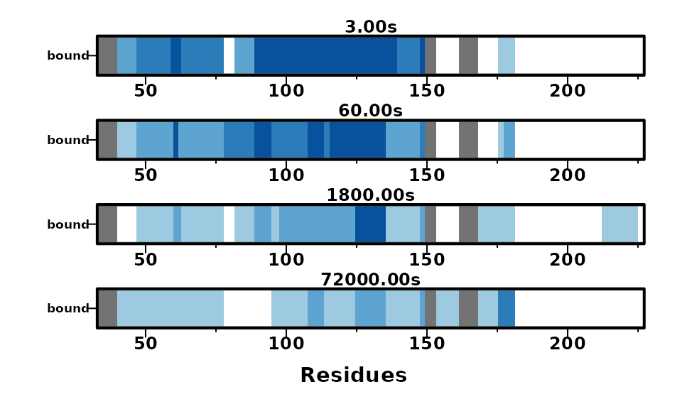

    #> NULL
    ##change some parameters
    plot_heat_map_tp(a, mar_x=1, 
                     ranges = c(-Inf, -10, -2.5,0,2.5, 10, Inf), pvalue=0.01)
    #> For time point 3.00s
    #> values range from  0 to 10.35 %
    #> Unbound bound range 0 10.35
    #> For time point 60.00s
    #> values range from  0 to 6.71 %
    #> Unbound bound range 0 6.71
    #> For time point 1800.00s
    #> values range from  0 to 3.11 %
    #> Unbound bound range 0 3.11
    #> For time point 72000.00s
    #> values range from  0 to 2.81 %
    #> Unbound bound range 0 2.81

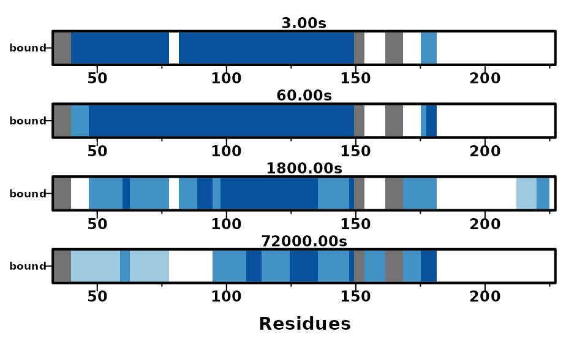

    #> NULL

    ### heat map for percent deuteration, require both uptake and percent deuteration data frame as input
    plot_heat_map_tp_proc(input_up = a, input_proc = b, replicates=3)
    #> For time point 3.00s
    #> values range from  -4.93 to 50.26 %
    #> Unbound bound range -4.93 50.26
    #> For time point 60.00s
    #> values range from  -8.11 to 33.38 %
    #> Unbound bound range -8.11 33.38
    #> For time point 1800.00s
    #> values range from  -11.17 to 21.97 %
    #> Unbound bound range -11.17 21.97
    #> For time point 72000.00s
    #> values range from  -52.9 to 4.58 %
    #> Unbound bound range -52.9 4.58

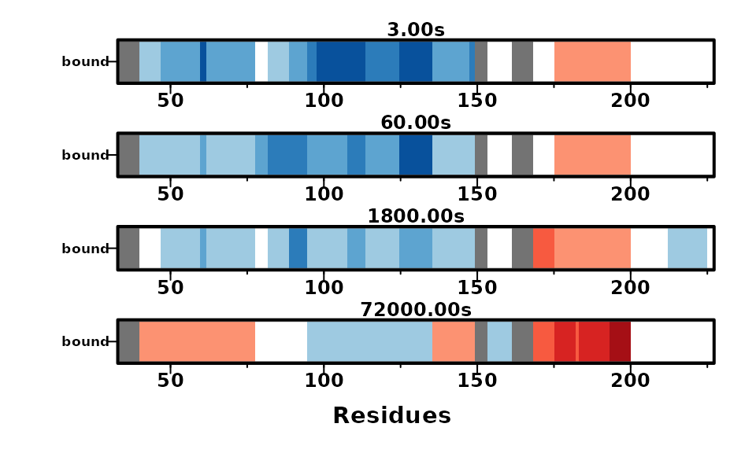

``` r


###Maximum uptake or percent deuteration per peptide
plot_heat_map_max_uptake_tp(a, replicates=3)
#> For timepoint 3.00s
#> values range from  0 to 5.68 %
#> Unbound bound range 0 5.68
#> For timepoint 60.00s
#> values range from  0 to 4.04 %
#> Unbound bound range 0 4.04
#> For timepoint 1800.00s
#> values range from  0 to 1.96 %
#> Unbound bound range 0 1.96
#> For timepoint 72000.00s
#> values range from  -0.99 to 6.01 %
#> Unbound bound range -0.99 6.01
```

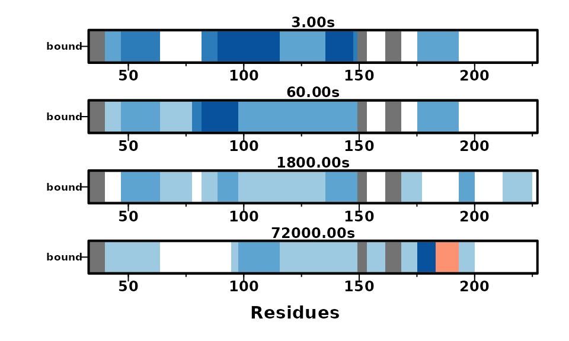

    #> NULL
    ### #
    plot_heat_map_max_uptake_tp_proc(input_up = a, input_proc = b, replicates=3, mar_x=1, ranges = c(-Inf, -10, -2.5,0,2.5, 10, Inf), pvalue=0.01)
    #> For time point 3.00s
    #> values range from  -9.86 to 35.61 %
    #> Unbound bound range -9.86 35.61
    #> For time point 60.00s
    #> values range from  -13.3 to 25.36 %
    #> Unbound bound range -13.3 25.36
    #> For time point 1800.00s
    #> values range from  -11.17 to 21.97 %
    #> Unbound bound range -11.17 21.97
    #> For time point 72000.00s
    #> values range from  -29.81 to 7 %
    #> Unbound bound range -29.81 7

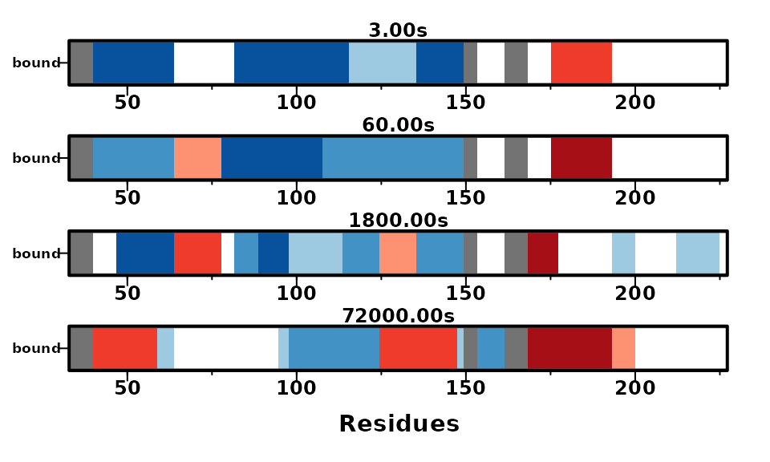

    #> NULL

``` r

## Legend for the heatmaps.
#default ranges for figures does not require argument
legend_heat_map(ranges = c(-Inf, -10, -2.5,0,2.5, 10, Inf))
```

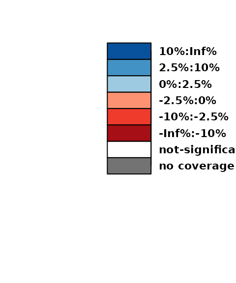

#### Woods Plots

Woods plots come in two flavors: one that looks at the time course or
timepoints. Below are examples. Selecting a few time points with
[`select_indices()`](https://mkajano.github.io/HDXBoxeR/reference/select_indices.md)
is recommended.

``` r

##
file_nm<-system.file("extdata", "All_results_table.csv", package = "HDXBoxeR") 


tp_aP<-output_tp(filepath = file_nm, percent=T) #timepoints
#> Protein.States used: Unbound bound
#> Deut.times used: 3.00s 60.00s 1800.00s 72000.00s
#> 29 peptide row(s) dropped: 29 not measured in every state, 0 with fewer than 2 replicate value(s)
#> Number of replicates used: Unbound=3 bound=3
#> no csv file written
indp<-select_indices(tp_aP,  times = c("3.00s", "60.00s"))
deuteration_woods_timepoints(tp_aP[indp,], replicates = 3)
```

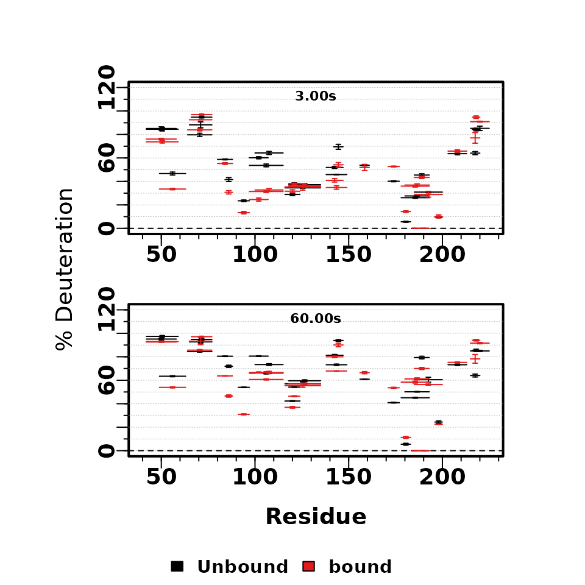

``` r


## input for timecourses 
tc_aP<-output_tc(filepath = file_nm, percent=T) #timecourse
#> Protein.States used: Unbound bound
#> Deut.times used: 3.00s 60.00s 1800.00s 72000.00s
#> 1 peptide row(s) dropped: 1 not measured in every time point, 0 with fewer than 2 replicate value(s)
#> Number of replicates used: 3.00s=3 60.00s=3 1800.00s=3 72000.00s=3
#> no csv file written
deuteration_woods_timecourse(tc_aP, replicates=3)
```

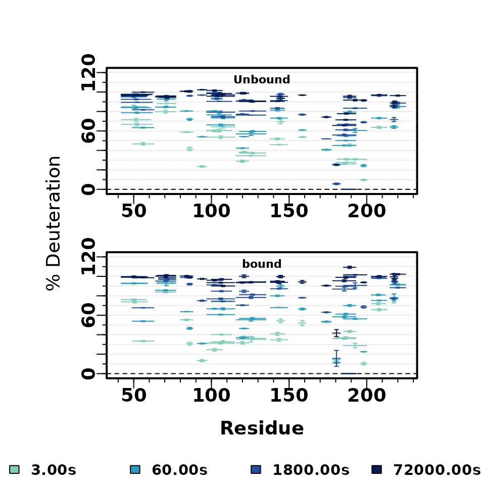

#### Timecourse Plots

Basic plots for the timecourse include average deuteration plots and the
heatmap. No significant peptide analysis was done in these plots. For
statistical analysis in timepoints, please use robot plots (see the next
section).

``` r

##
file_nm<-system.file("extdata", "All_results_table.csv", package = "HDXBoxeR") 
## input for timecourses for procent deuteration and uptake
tc_aP<-output_tc(filepath = file_nm, percent=T)
#> Protein.States used: Unbound bound
#> Deut.times used: 3.00s 60.00s 1800.00s 72000.00s
#> 1 peptide row(s) dropped: 1 not measured in every time point, 0 with fewer than 2 replicate value(s)
#> Number of replicates used: 3.00s=3 60.00s=3 1800.00s=3 72000.00s=3
#> no csv file written

## average procent deuteration in timecourse
plots_av_tcourse(tc_aP, replicates = 3)
```

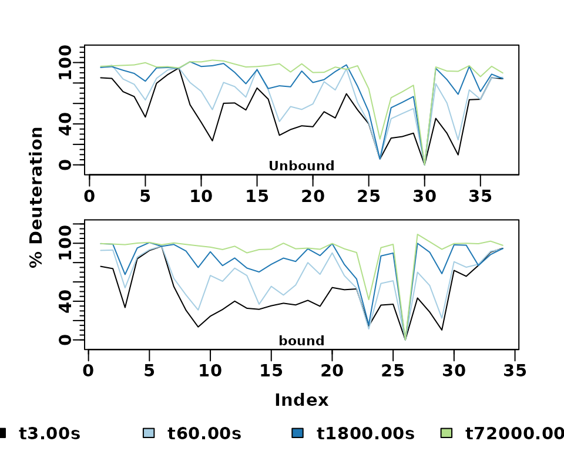

``` r

###average heat map for timecourses
plot_heat_map_tc(tc_aP, replicates=3)
#> values range from  0 to 102.36 %
#> t3.00s range 0 87.56
#> t60.00s range 0 90.66
#> t1800.00s range 0 100.81
#> t72000.00s range 0 102.36
#> values range from  0 to 102.17 %
#> t3.00s range 0 91.14
#> t60.00s range 0 92.79
#> t1800.00s range 0 99.34
#> t72000.00s range 0 102.17
```

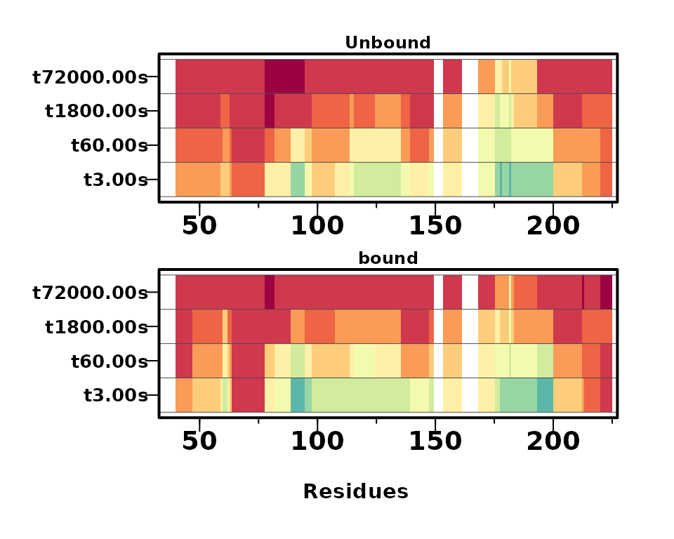

    #> NULL
    legend_heat_map_timecourse()

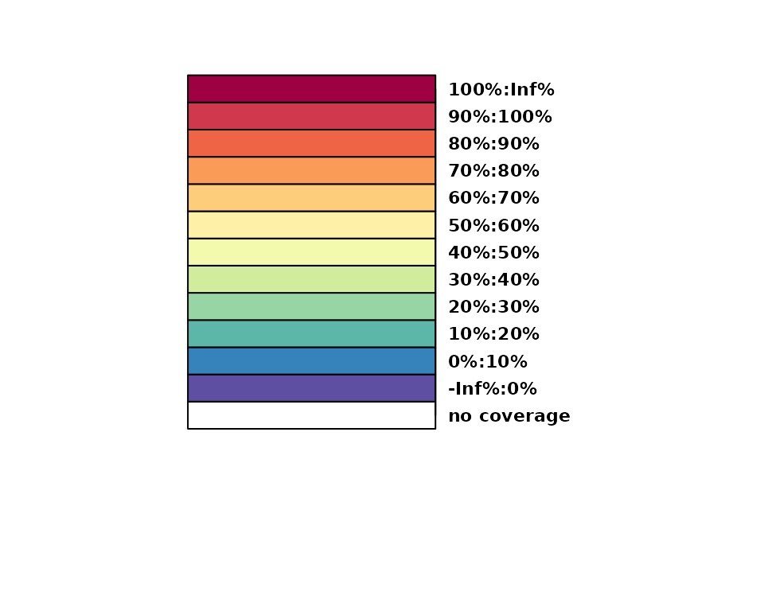

#### Robot Plots

The robot plots are a modification of the butterfly plots. The main
difference is that while in the butterfly plots peptides were depicted
as a single dot in the middle of the peptide, in robot plot peptides,
the whole peptide length is drawn. This replaces butterfly plots’ nice
curves with hard edges, which could not be called a delicate butterfly
but rather the clinical look of a robotic machine.

The robot plots choose only significant peptides to be drawn. If the
peptide is significant in one timepoint, it will be drawn at all
time-points, but only significantly different peptides will be colored.
The robot plots compare two different data sets: one is drawn above the
x-axis, the other below the x-axis.

``` r

###load data
library(HDXBoxeR)
file_nm<-system.file("extdata", "All_results_table.csv", package = "HDXBoxeR") 
## input for timecourses for procent deuteration and uptake
tc_a<-output_tc(filepath = file_nm)
#> Protein.States used: Unbound bound
#> Deut.times used: 3.00s 60.00s 1800.00s 72000.00s
#> 1 peptide row(s) dropped: 1 not measured in every time point, 0 with fewer than 2 replicate value(s)
#> Number of replicates used: 3.00s=3 60.00s=3 1800.00s=3 72000.00s=3
#> no csv file written
tc_aP<-output_tc(filepath = file_nm, percent=TRUE)
#> Protein.States used: Unbound bound
#> Deut.times used: 3.00s 60.00s 1800.00s 72000.00s
#> 1 peptide row(s) dropped: 1 not measured in every time point, 0 with fewer than 2 replicate value(s)
#> Number of replicates used: 3.00s=3 60.00s=3 1800.00s=3 72000.00s=3
#> no csv file written

###All peptides drawn 
robot_plot_All(thP = tc_aP, th=tc_a, pvalue = 0.01,alpha=0.01)
```

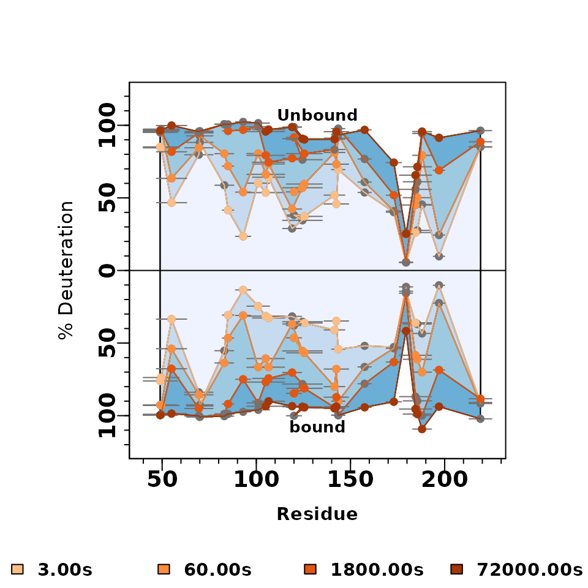

``` r

###USe more stingent parameters to have less peptides drawn. alpha modifies the CI values (works similarly to p-value)
robot_plot_All(thP = tc_aP, th=tc_a, pvalue = 0.001, alpha=0.01)
```

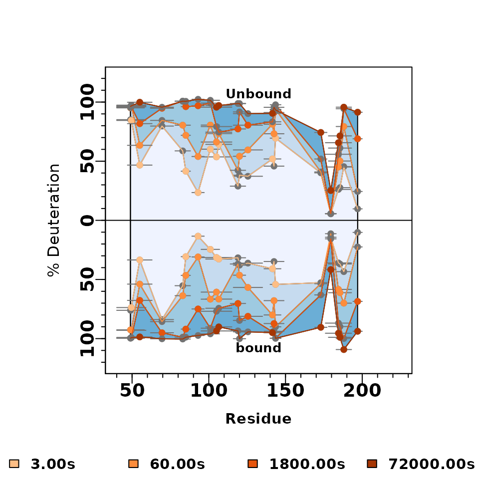

If the robot plots are too crowded, we recommend removing peptides from
the robot plot by making the p-value and critical interval more
stringent. However, even then, some areas of the plot are too crowded,
so manual removal of peptides is necessary to prepare a final plot. To
determine which peptides should be removed (or kept), we recommend first
looking at the plot and then running the
[`robot_indexes_df()`](https://mkajano.github.io/HDXBoxeR/reference/robot_indexes_df.md)
function, which returns all significant peptides in the set. After that,
one should choose indexes that the user wants to keep and run the
[`robot_2states_indexes()`](https://mkajano.github.io/HDXBoxeR/reference/robot_2states_indexes.md)
function.
[`robot_indexes_df()`](https://mkajano.github.io/HDXBoxeR/reference/robot_indexes_df.md)
lists significant peptides for every state compared with the first one.
[`robot_2states_indexes()`](https://mkajano.github.io/HDXBoxeR/reference/robot_2states_indexes.md)
draws two states: give them with `states`.

    #> Protein.States used: Unbound bound
    #> Deut.times used: 3.00s 60.00s 1800.00s 72000.00s
    #> 1 peptide row(s) dropped: 1 not measured in every time point, 0 with fewer than 2 replicate value(s)
    #> Number of replicates used: 3.00s=3 60.00s=3 1800.00s=3 72000.00s=3
    #> no csv file written
    #> Protein.States used: Unbound bound
    #> Deut.times used: 3.00s 60.00s 1800.00s 72000.00s
    #> 1 peptide row(s) dropped: 1 not measured in every time point, 0 with fewer than 2 replicate value(s)
    #> Number of replicates used: 3.00s=3 60.00s=3 1800.00s=3 72000.00s=3
    #> no csv file written
    #>    nb Start End              Sequence Charge
    #> 1   1    40  58   GPLGSKAVVPGPAEHPLQY      2
    #> 2   2    40  59  GPLGSKAVVPGPAEHPLQYN      2
    #> 3   3    47  63     VVPGPAEHPLQYNYTFW      2
    #> 4   4    62  77      FWYSRRTPGRPTSSQS      3
    #> 5   5    78  88           YEQNIKQIGTF      2
    #> 6   6    82  88               IKQIGTF      2
    #> 7   7    89  97             ASVEQFWRF      2
    #> 8   8    95 107         WRFYSHMVRPGDL      3
    #> 9   9    95 115 WRFYSHMVRPGDLTGHSDFHL      3
    #> 10 10    98 115    YSHMVRPGDLTGHSDFHL      2
    #> 11 11   116 135  FKEGIKPMWEDDANKNGGKW      3
    #> 12 12   136 147          IIRLRKGLASRC      3
    #> 13 13   136 149        IIRLRKGLASRCWE      3
    #> 14 14   140 147              RKGLASRC      2
    #> 15 15   169 177             AVVSVRFQE      2
    #> 16 16   176 183              QEDIISIW      2
    #> 17 17   176 193    QEDIISIWNKTASDQATT      2
    #> 18 18   178 193      DIISIWNKTASDQATT      2
    #> 19 19   183 193           WNKTASDQATT      2
    #> 20 20   194 200               ARIRDTL      2

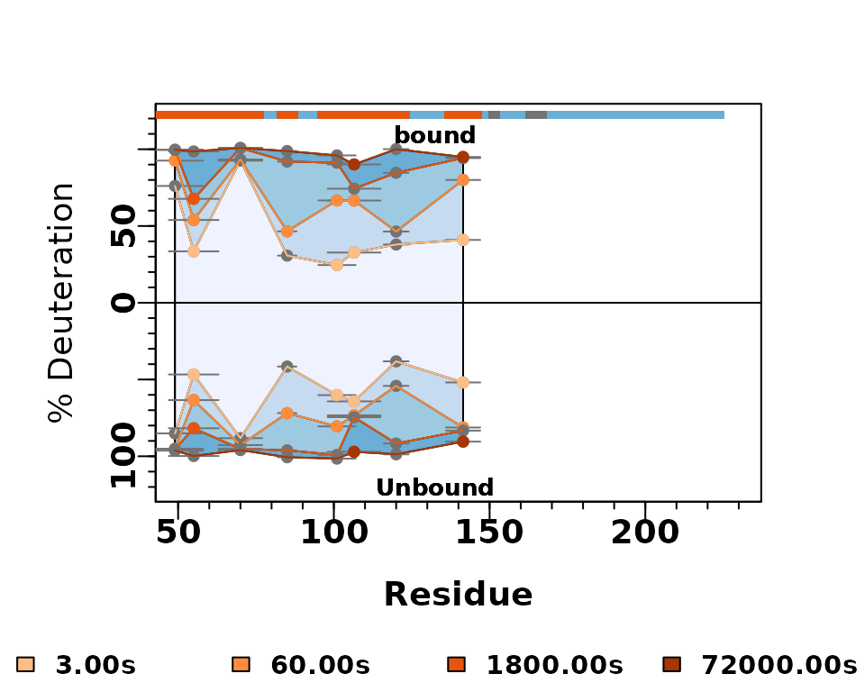

#### Woods_CI plots

Very similar to robot plots, but slightly different representation.

``` r

###load data
library(HDXBoxeR)
file_nm<-system.file("extdata", "All_results_table.csv", package = "HDXBoxeR") 
## input for timecourses for procent deuteration and uptake
tc_a<-output_tc(filepath = file_nm)
#> Protein.States used: Unbound bound
#> Deut.times used: 3.00s 60.00s 1800.00s 72000.00s
#> 1 peptide row(s) dropped: 1 not measured in every time point, 0 with fewer than 2 replicate value(s)
#> Number of replicates used: 3.00s=3 60.00s=3 1800.00s=3 72000.00s=3
#> no csv file written
tc_aP<-output_tc(filepath = file_nm, percent=TRUE)
#> Protein.States used: Unbound bound
#> Deut.times used: 3.00s 60.00s 1800.00s 72000.00s
#> 1 peptide row(s) dropped: 1 not measured in every time point, 0 with fewer than 2 replicate value(s)
#> Number of replicates used: 3.00s=3 60.00s=3 1800.00s=3 72000.00s=3
#> no csv file written

###All peptides drawn 
woods_CI_plot(thP = tc_aP, th=tc_a)
```

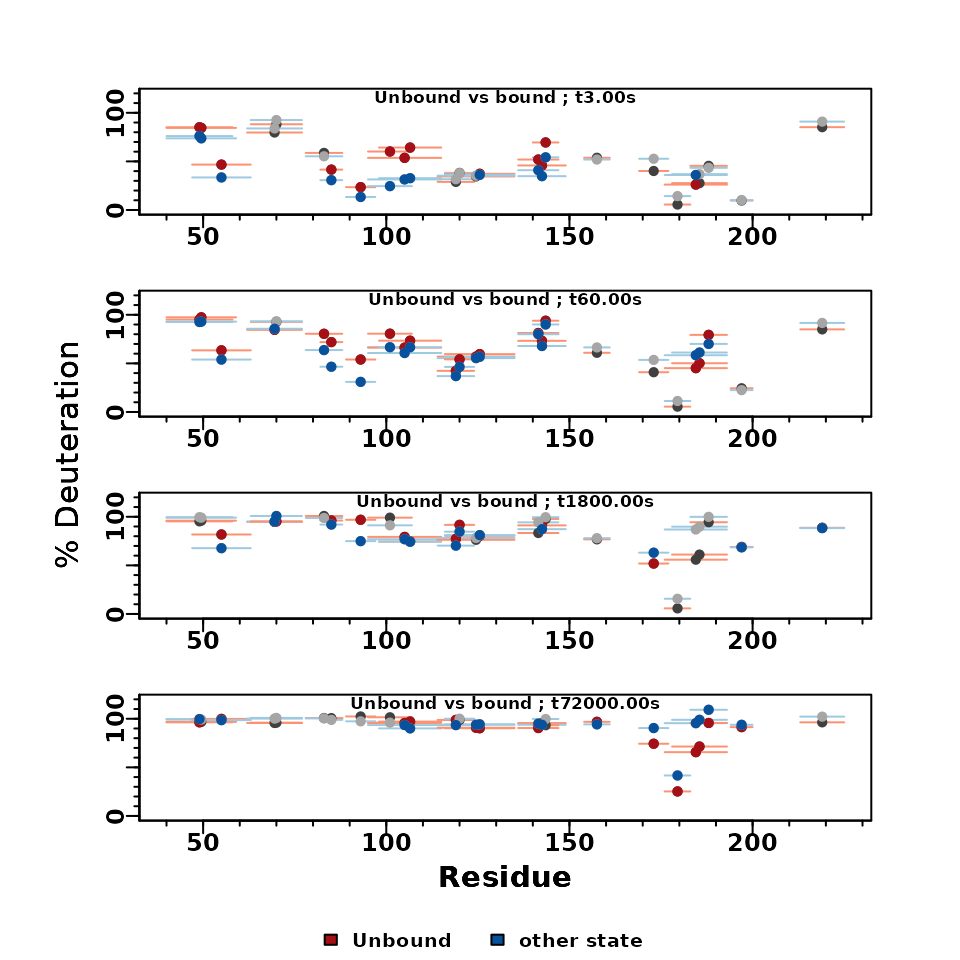

``` r

###USe more stingent parameters to have less peptides drawn. alpha modifies the Critial interval. 
woods_CI_plot(thP = tc_aP, th=tc_a, pvalue=0.005, alpha=0.001)
```

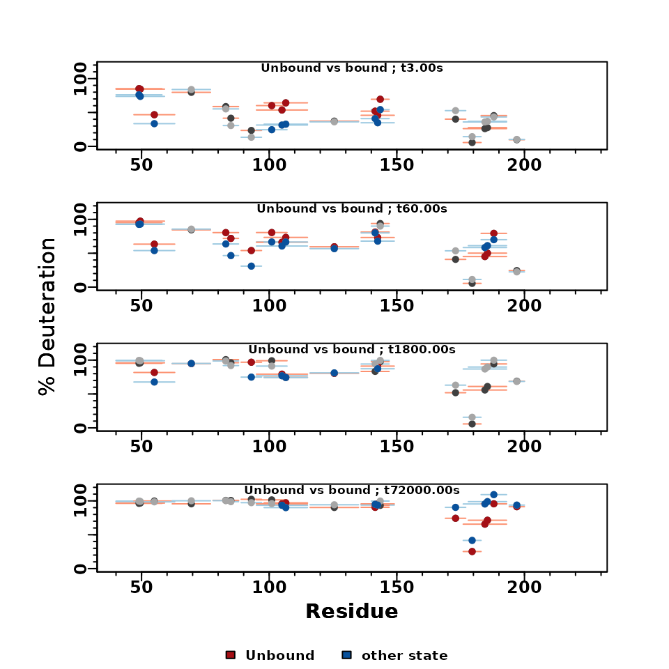

### 6. Scripts for Pymol

HDXBoxeR prepares scripts for Pymol based on the statistical analysis,
assigning colors corresponding to significantly different peptides.
Separate scripts are written for each time-point and Protein State. The
colors assigned for Pymol scripts are the same as used in the plots
(sig_peptides and heat maps), allowing for a direct comparison between
the plots and the structures. The Pymol scripts are saved in the working
directory. Additionally, HDXBoxeR gives an option to color residues on
the structures using averaging schemes described in heatmaps plots
preparation. Legends are generated by default.

### 7. Summary Information Generation about Data Sets

HDXBoxeR has the functionality to return summary information about the
sets, including timepoints, number of replicates, number of peptides,
peptide coverage, average peptide length, average redundancy, standard
deviation, critical interval, average back exchange, and back exchange
range. The information provided complies with Masson et al., Nature
Methods volume 16, pages 595–602 (2019).

The
[`all_summary()`](https://mkajano.github.io/HDXBoxeR/reference/all_summary.md)
function requires undeuterated and fully deuterated sets marked in
Deut.time as 0s and FD, respectively. Also, for the calculation of the
back exchange, the Dfact parameter needs to be specified. The Dfact is
the fraction of Deuterium/Hydrogen used in the labeling buffer, with the
default set up to 0.85.

``` r

file_nm<-system.file("extdata", "All_results_table.csv", package = "HDXBoxeR")

all_summary(file_nm, Dfact=0.85,replicates = 3, alpha=0.01)
#>         Protein.State                      Timepoints # replicates # peptides
#> Unbound       Unbound 3.00s 60.00s 1800.00s 72000.00s            3         37
#> bound           bound 3.00s 60.00s 1800.00s 72000.00s            3         34
#>         peptide coverage % <Peptide Length> <Redundancy> st.dev    CI <BackHX>
#> Unbound              94.09            13.86         2.93  0.067 0.179    27.01
#> bound                94.09            13.29         2.58  0.076 0.203    35.44
#>         BackHX Range From    To
#> Unbound              1.31 51.48
#> bound               11.73 99.88
```

[`hdx_summary_table()`](https://mkajano.github.io/HDXBoxeR/reference/hdx_summary_table.md)
lays the same numbers out as the summary table recommended by Masson et
al. (one row per item, one column per state) and adds your own
experimental details through `metadata`; `file = "summary.md"` or
`"summary.csv"` saves it.

``` r

hdx_summary_table(file_nm, metadata = list(
  "HDX reaction details" = "describe buffer, pD, D2O %, temperature",
  "Data analysis software" = "HDExaminer; HDXBoxeR"))
#>                               Item                                  Unbound
#> 1             HDX reaction details  describe buffer, pD, D2O %, temperature
#> 2           Data analysis software                     HDExaminer; HDXBoxeR
#> 3                  HDX time course          3.00s 60.00s 1800.00s 72000.00s
#> 4                     HDX controls undeuterated (0s); fully deuterated (FD)
#> 5             Number of replicates                                        3
#> 6               Number of peptides                                       37
#> 7            Sequence coverage (%)                  94.09 (residues 40-225)
#> 8           Average peptide length                                    13.86
#> 9                       Redundancy                                     2.93
#> 10 Back-exchange (%): mean (range)                     27.01 (1.31 - 51.48)
#> 11   Repeatability (pooled SD, Da)                                    0.067
#> 12  Significant differences in HDX                          reference state
#>                                                                               bound
#> 1                                           describe buffer, pD, D2O %, temperature
#> 2                                                              HDExaminer; HDXBoxeR
#> 3                                                   3.00s 60.00s 1800.00s 72000.00s
#> 4                                          undeuterated (0s); fully deuterated (FD)
#> 5                                                                                 3
#> 6                                                                                34
#> 7                                                           94.09 (residues 40-225)
#> 8                                                                             13.29
#> 9                                                                              2.58
#> 10                                                            35.44 (11.73 - 99.88)
#> 11                                                                            0.076
#> 12 |difference| > 0.20-0.35 Da (critical interval, alpha = 0.01) and Welch p < 0.01
```

### 8. Outputs

HDXBoxeR reprocesses the HDX-MS data and calculates statistical
parameters from it. Data can be exported automatically in different
outputs depending on user needs. It can prepare a format that would be
ready for publication. It can also return a simple .csv with all the
peptides matched between the sets or provide a verbose output which
includes peptides’ standard deviation and p-value per peptide.

``` r

file_nm<-system.file("extdata", "All_results_table.csv", package = "HDXBoxeR")

### tidy table of every peptide, time point and comparison, with the significance call;
### also writes results_parameters.txt with the settings and sessionInfo()
hdx_results_table(file_nm, p_adjust = "BH", file = "results.csv")

### everything at once: an HTML report with summary, quality checks, plots and tables
render_report(file_nm, output_file = "hdx_report.html")

###final output for the paper
### USAGE output_prep(pathto_allresults.csv, output_name.csv)
output_prep(filepath = file_nm, output_name = tempfile())

###long version of the uptake data, timepoint
### to save file provide a output name to csv flag
output_tp(filepath =file_nm , csv = tempfile())


### verbose versions of the output functions create csv files with all important data averages, sd, and pvalues for uptake data
verbose_timepoint_output(filepath = file_nm, output_name =tempfile())
verbose_timepoint_output(filepath = file_nm, output_name = tempfile(), percent=T)
```

### 9. Preparation Inputs for Bimodal Analysis for HX-Express v2

To perform bimodal analysis using HX-Express v2 (J. Am. Soc. Mass
Spectrom. 2013, 24, 12, 1906–1912), spectra aligned using MassLynx need
to be combined into one input. The input file contains all replicates
and all the time points. HDXBoxeR prepares the inputs for HX-Express v2.
The function has to be invoked in the folder where all the directories
containing peptides are. HDXBoxeR will loop through all the folders and
write outputs for all peptides for which information was provided.

``` r

# returns empty column if data is missing
path_to_folders<-system.file("extdata",  package = "HDXBoxeR")

extreme_input_gap(hm_dir =path_to_folders, replicates = 3, 
                  timepoints =c(3, 60, 1800, 72000), output_path=tempdir())
# if data is missing, it writes there values for undeuterated 
extreme_input_undeut(hm_dir =path_to_folders, replicates = 2, 
                     timepoints =c(3, 60, 1800, 72000), output_path=tempdir())
```

### 10. Proposed Workflow.

``` r


library(HDXBoxeR)
file_nm<-system.file("extdata", "All_results_table.csv", package = "HDXBoxeR") 

############################
## Load data
###########################

##########Deuteration uptake vs procent deuteration file preparation
#### Input for uptake deuteration
a<-output_tp(file_nm) 
# input for percent deuteration
b<-output_tp(file_nm, percent=T) 

# Time courses inputs
tc_a<-output_tc(filepath = file_nm)
tc_aP<-output_tc(filepath = file_nm, percent=T)


###########################
##definition of some important variables
###################

states<-arguments_call1(filepath=file_nm)
times<-arguments_call2(filepath=file_nm, states=states)
replicates<-arguments_call3(filepath=file_nm, states=states, times=times)

######################################
## Statistical analysis
#####################################

###average calculation for all peptides
av1<-ave_timepoint(a)
###average differences (against first Protein State in the file)
da1<-dif_ave(av1)
###standard deviation calculation for all peptides
sd1<-sd_timepoint(a)
### Global critical interval for 1 protein sets
CI_single(s1 =sd1[,7], replicates = 3 )
##Global critical interval for 2 protein sets
CI_2pts(s1 = sd1[,7], s2=sd1[,8], replicates = 3)
##individual peptide p-value calculation against first set in the input file
pv1<-pv_timepoint(a)

## Plots

##uptake plots

# define the timepoint using in the experiment. Here the times in seconds
x<-c(4, 60,1800, 72000)
#par(mfrow=c(1,2))
uptake_plots(tc_aP[1:2,],x)


# Boxplots
boxplot_tp(a, col= c("gold2", "dodgerblue"))

# Volcano plots
plots_vol_tp(a, col=c(2,3), replicates=3, pvalue = 0.01)

# Significantly different peptides plot across the sequence
#par(mfrow=c(4,1)) # uncomment to have 4 panels
plot_peptide_sig_tp(a,nb_pep_row = 18, ranges = c(-Inf, -10, -2.5,0,2.5, 10, Inf), pvalue = 0.01) 

##Average uptake heat maps
### heat maps 
plot_heat_map_tp(a, mar_x=8, ranges = c(-Inf, -10, -2.5,0,2.5, 10, Inf), pvalue=0.01)

### heat map for procent deuteration, require both uptake and procent deuteration data frame as input
plot_heat_map_tp_proc(input_up = a, input_proc = b, replicates=3)

###Maximum uptake or procent deuteration per peptide
plot_heat_map_max_uptake_tp(a, replicates=3)
### 
plot_heat_map_max_uptake_tp_proc(input_up = a, input_proc = b, replicates=3, mar_x=8, ranges = c(-Inf, -10, -2.5,0,2.5, 10, Inf), pvalue=0.01)

## Legend for the heatmaps.
#default ranges for figures does not require argument
legend_heat_map(ranges = c(-Inf, -10, -2.5,0,2.5, 10, Inf))

######################
###Timecourses plots
######################

## average procent deuteration in timecourse
plots_av_tcourse(tc_aP, replicates = 3)
###average heat map for timecourses
plot_heat_map_tc(tc_aP, replicates=3)
legend_heat_map_timecourse()

###Robot plots for the timecourses
robot_plot_All(thP = tc_aP, th=tc_a, pvalue=0.01)

##############Woods plots
##timecourse and timepoint woods plots
################

indp<-select_indices(b,  times = c("3.00s", "60.00s"))
deuteration_woods_timepoints(b[indp,], replicates = 3)

## input for timecourses 
deuteration_woods_timecourse(tc_aP, replicates=3)

###woods plots
woods_CI_plot(thP = tc_aP, th=tc_a)
###Use more stringent parameters to have fewer peptides drawn: lower pvalue and alpha (critical interval).
woods_CI_plot(thP = tc_aP, th=tc_a, pvalue=0.005, alpha = 0.001)


#######################
##Pymol scripts
#######################

pymol_script_significant_peptide(a, path=tempdir(), ranges=c(-Inf, seq(-120, 120, by=10), Inf), pvalue = 0.01,replicates = 3)
###same but for percent deuteration
pymol_script_significant_peptide_proc(input_proc = b, input_up = a,path=tempdir(), ranges=c(-Inf, seq(-120, 120, by=10), Inf), pvalue = 0.01,replicates = 3, order.pep=FALSE)

###scripts prepared by residue
pymol_script_significant_residue(a, path=tempdir(), ranges=c(-Inf, seq(-120, 120, by=10), Inf), pvalue = 0.01,replicates = 3)

##################
##Summary
##################
all_summary(file_nm, Dfact=0.85,replicates = 3)

###############
##Outputs
###############

###final output for the paper 
### USAGE output_prep(pathto_allresults.csv, output_name.csv)
output_prep(filepath = file_nm, output_name = tempfile())

###long version of the uptake data, timepoint
### USAGE output_tp_csv(pathto_allresults.csv, output_name.csv)
output_tp(filepath =file_nm , csv = tempfile())

### verbose versions of the output functions create csv files with all important data averages, sd, and pvalues for uptake data
verbose_timepoint_output(filepath = file_nm, output_name = tempfile(), percent=TRUE)

###########################
##Extreme input preparation
###########################

# returns empty column if data is missing
extreme_input_gap(hm_dir ="filepath", replicates = 3, 
                  timepoints =c(3, 60, 1800, 72000), output_path=tempdir())
# if data is missing, it writes there values for undeuterated 
extreme_input_undeut(hm_dir ="filepath", replicates = 2,
                     timepoints =c(3, 60, 1800, 72000), output_path=tempdir())
```

### 11. List of all functions & parameters.

``` r

##All functions with arguments
lsf.str("package:HDXBoxeR")
#> all_data_long_input : function (filepath)  
#> all_summary : function (filepath, replicates = NULL, Dfact = 0.85, alpha = 0.01, protein_range = NULL)  
#> arg_df : function (filepath)  
#> arg_UN_FD : function (filepath)  
#> arguments_call1 : function (filepath)  
#> arguments_call2 : function (filepath, states)  
#> arguments_call3 : function (filepath, states, times)  
#> as_hdx_long : function (data, state, time, replicate, start, end, sequence, uptake, charge = NULL, 
#>     percent = NULL, rt = NULL, centroid = NULL, time_unit = c("s", "min", 
#>         "h"), undeuterated = 0, fd = NULL)  
#> av_tc : function (df, col, cola)  
#> av_tp : function (df, col, cola)  
#> ave_timepoint : function (df, replicates = 3)  
#> average_timecourse : function (filepath)  
#> backHX_calculations : function (filepath, Dfact = 0.85)  
#> boxer_input_to_long : function (filepath, replicates, states, times, seq_match = FALSE, csv = "NA", 
#>     percent = FALSE)  
#> boxplot_tp : function (df, replicates = 3, ...)  
#> CI_2pts : function (s1, s2, replicates = 3, alpha = 0.01, n1 = NULL, n2 = NULL)  
#> CI_single : function (s1, replicates = 3, alpha = 0.01)  
#> CI_tc : function (sd_c, sd_v, replicates = 3, alpha = 0.01)  
#> CI_tp : function (df, replicates = 3, alpha = 0.01)  
#> color_ranges_Blue_Red_heat_map : function (ranges, col, colors_initial)  
#> color_ranges_Spectral : function (ranges, col, colors_initial)  
#> compare_regions : function (filepath, times, regions, states = NULL, reference = NULL, by = c("sequence", 
#>     "position"), replicates = NULL, percent = FALSE, time_model = FALSE, 
#>     p_adjust = "none")  
#> compare_states_tp : function (filepath, times, states = NULL, by = c("sequence", "position"), 
#>     reference = NULL, regions = NULL, replicates = NULL, alpha = 0.01, 
#>     pvalue = 0.01, p_adjust = "none", omnibus = c("welch", "kruskal"), 
#>     percent = FALSE, p_adjust_method)  
#> compare_states_unmatched : function (filepath, times, regions, states = NULL, value = c("raw", "percent", 
#>     "frac_deut"), method = c("peptide", "classic", "resample"), reference = NULL, 
#>     replicates = 3, pvalue = 0.01, alpha = 0.01, p_adjust = "none", n_perm = 1000, 
#>     n_boot = 1000, seed = NULL, p_adjust_method)  
#> compare_timecourse : function (filepath, state1, state2, times, alpha = 0.01, pvalue = 0.01, 
#>     p_adjust = "none", min_timepoints = 2, percent = FALSE, replicates = NULL)  
#> coverage_residue : function (df1, start_col, end_col)  
#> deuteration_woods_timecourse : function (input_data, states, replicates = 3, ylim = c(0, 120), ...)  
#> deuteration_woods_timecourse_frac : function (input_data, states, replicates = 3, ylim = c(0, 1.2), ...)  
#> deuteration_woods_timepoints : function (input_data, times, replicates = 3, col = NA, ylim = c(0, 120), 
#>     ..., cola)  
#> deuteration_woods_timepoints_frac : function (input_data, times, replicates = 3, col = NA, ylim = c(0, 1.1), 
#>     ..., cola)  
#> deuteration_woods_timepoints_frac_list : function (list_input_data, times, replicates = 3, col = NA, ylim = c(0, 
#>     1.1), ..., cola)  
#> dif_ave : function (df)  
#> dif_tp : function (df, col, cola)  
#> dif_tp_proc : function (df, col, cola)  
#> diff_peptides_prep : function (df, replicates = 3, pvalue = 0.01, alpha = 0.01, p_adjust = "none", 
#>     pv_cutoff)  
#> duplicate_sets : function (df)  
#> extreme_input_gap : function (hm_dir, replicates, timepoints, output_path = "NA")  
#> extreme_input_undeut : function (hm_dir, replicates, timepoints, output_path = "NA")  
#> general_info : function (filepath, protein_range = NULL)  
#> getCoords1 : function (pos = 1.1, side = 1, input = "p")  
#> hdx_results_table : function (filepath, states, times, reference, all_pairs = FALSE, alpha = 0.01, 
#>     pvalue = 0.01, p_adjust = "none", percent = FALSE, replicates = NULL, 
#>     file = NULL)  
#> hdx_summary_table : function (filepath, metadata = list(), replicates = NULL, Dfact = 0.85, 
#>     alpha = 0.01, pvalue = 0.01, protein_range = NULL, file = NULL, states = NULL)  
#> heat_map_tc : function (df, ranges = c(seq(0, 100, by = 10), Inf))  
#> heat_map_tp : function (df, pv, sd, ranges = c(-Inf, seq(-30, 30, by = 10), Inf), alpha = 0.01, 
#>     pvalue = 0.01, replicates = 3, pv_cutoff)  
#> heat_map_tp_maxuptake : function (df, pv, sd, ranges = c(-Inf, seq(-30, 30, by = 10), Inf), alpha = 0.01, 
#>     pvalue = 0.01, replicates = 3, pv_cutoff)  
#> heat_map_tp_maxuptake_proc : function (df, dfup, pv, sd, ranges = c(-Inf, seq(-30, 30, by = 10), Inf), 
#>     alpha = 0.01, pvalue = 0.01, replicates = 3, pv_cutoff)  
#> heat_map_tp_proc : function (df, dfup, pv, sd, ranges = c(-Inf, seq(-30, 30, by = 10), Inf), 
#>     alpha = 0.01, pvalue = 0.01, replicates = 3, pv_cutoff)  
#> interactive_fissure_explorer : function (df, state1, state2, times, replicates = 3, alpha = 0.01, pvalue = 0.01, 
#>     p_adjust = "none")  
#> interactive_fissure_vent : function (df, state1, state2, times, replicates = 3, alpha = 0.01, pvalue = 0.01, 
#>     shared_data = NULL, p_adjust = "none")  
#> interactive_volcano : function (df, state1, state2, times, replicates = 3, alpha = 0.01, pvalue = 0.01, 
#>     shared_data = NULL, p_adjust = "none")  
#> interactive_woods : function (df, state1, state2, times, replicates = 3, alpha = 0.01, pvalue = 0.01, 
#>     shared_data = NULL, p_adjust = "none")  
#> lab_dif : function (df, col, cola)  
#> lab_dif_proc : function (df, col, cola)  
#> lab_vol : function (df, col, cola)  
#> legend_heat_map : function (ranges = c(-Inf, seq(-30, 30, by = 10), Inf))  
#> legend_heat_map_tc : function (df)  
#> legend_heat_map_timecourse : function (ranges = c(-Inf, seq(0, 100, by = 10), Inf))  
#> legend_heat_map_tp : function (df)  
#> legend_heat_map_tp_proc : function (df)  
#> legend_nm_bottom : function (names, cols)  
#> legend_raw_ave : function (df, col, cola)  
#> legend_raw_ave_proc : function (df, col, cola)  
#> legend_raw_ave_tc : function (df, col, cola)  
#> legend_sig_peptides : function (ranges = c(-Inf, seq(-30, 30, by = 10), Inf))  
#> legend_states_PerD_bottom : function (df, cols)  
#> legend_tc_bottom : function (df, cols)  
#> nb_exch_deut : function (df)  
#> nm_states : function (filepath)  
#> output_FD : function (filepath)  
#> output_FD_proc : function (filepath)  
#> output_prep : function (filepath, output_name, states, replicates = NULL, times, percent = FALSE)  
#> output_tc : function (filepath, replicates, states, times, seq_match = FALSE, csv = "NA", 
#>     percent = FALSE, min_replicates = 2)  
#> output_tp : function (filepath, replicates, states, times, seq_match = FALSE, csv = "NA", 
#>     percent = FALSE, min_replicates = 2, .arg_df = NULL)  
#> output_UD : function (filepath)  
#> output_UD_proc : function (filepath)  
#> pallette_legend : function (col_pallette)  
#> pallette_ll : function (pallette, lab)  
#> peptide_pv_tp : function (df, pv, sd, nb_row, ranges = c(-Inf, seq(-30, 30, by = 10), Inf), 
#>     alpha = 0.01, pvalue = 0.01, replicates = 3, pv_cutoff)  
#> peptide_pv_tp_proc : function (df, dfup, pv, sd, nb_row = 100, ranges = c(-Inf, seq(-30, 30, 
#>     by = 10), Inf), alpha = 0.01, pvalue = 0.01, replicates = 3, pv_cutoff)  
#> peptide_qc : function (filepath)  
#> pl_gen_ch_frac : function (df, ddlab = 3, ...)  
#> pl_gen_ch_list_frac : function (min_x, max_x, ddlab = 3, ...)  
#> pl_gen_ch2 : function (df, ddlab = 1, ...)  
#> pl_gen_uptake : function (df, timepoints, ddlab = 1, ...)  
#> plot_compare_states_tp : function (res, plot_type = c("jitter", "box", "violin"), sig_col = "firebrick", 
#>     nonsig_col = "grey55", summary_col = "steelblue", tint = 0.6, point_cex = 0.9, 
#>     jitter_width = 0.15, show_zero = TRUE, bg = "grey95", grid_col = "white", 
#>     show_grid = TRUE, cex_annot = 0.9, font_family = "")  
#> plot_compare_states_unmatched : function (res, plot_type = c("jitter", "box", "violin"), palette = "Set2", 
#>     digits = 3, state_labels = NULL, cex_annot = 1, show_points = TRUE, 
#>     point_cex = 0.9, jitter_width = 0.15, tint = 0.55, notch = FALSE, bg = "grey95", 
#>     grid_col = "white", show_grid = TRUE, font_family = "")  
#> plot_cor_pts_elps : function (df, replicates = 3, times, state1, state2, position_col = NA, 
#>     length1 = NA, xlim = NULL, ylim = NULL, ...)  
#> plot_correlation_functions : function (df, replicates = 3, ranges, mar_x = 1)  
#> plot_coverage_diagnostics : function (res, low_threshold = 0.5, palette = "Set2", warn_col = "firebrick", 
#>     ok_col = "grey55", bg = "grey95", grid_col = "white", show_grid = TRUE, 
#>     legend = TRUE, cex_main = 1, font_family = "")  
#> plot_fissure_vent : function (df, replicates = 3, times, state1, state2, alpha = 0.01, pvalue = 0.01, 
#>     position_col = NA, sd_source = "raw", length1 = NA, xlim = NULL, ylim = NULL, 
#>     sig_col = "firebrick", nonsig_col = "grey60", fill_alpha = 0.3, p_adjust = "none", 
#>     ...)  
#> plot_hdx_structure : function (res_df, pdb, state1, state2, times, chain = NULL, resno_offset = 0, 
#>     ranges = NULL, col = "grey80", background = "white", colors_initial)  
#> plot_hdx_structure_legend : function (ranges, col = "grey80", unit_label = "", colors_initial)  
#> plot_heat_map_max_uptake_tp : function (df, replicates = 3, mar_x = 3.5, ranges = c(-Inf, seq(-30, 30, 
#>     by = 10), Inf), alpha = 0.01, pvalue = 0.01, p_adjust = "none", pv_cutoff)  
#> plot_heat_map_max_uptake_tp_proc : function (input_proc, input_up, mar_x = 3.5, ranges = c(-Inf, seq(-30, 
#>     30, by = 10), Inf), alpha = 0.01, pvalue = 0.01, replicates = 3, p_adjust = "none", 
#>     pv_cutoff)  
#> plot_heat_map_tc : function (df, replicates = 3, mar_x = 3.5, ranges = c(-Inf, seq(0, 100, 
#>     by = 10), Inf))  
#> plot_heat_map_tp : function (df, mar_x = 3.5, ranges = c(-Inf, seq(-30, 30, by = 10), Inf), 
#>     alpha = 0.01, pvalue = 0.01, replicates = 3, p_adjust = "none", pv_cutoff)  
#> plot_heat_map_tp_proc : function (input_proc, input_up, mar_x = 3.5, ranges = c(-Inf, seq(-30, 
#>     30, by = 10), Inf), alpha = 0.01, pvalue = 0.01, replicates = 3, p_adjust = "none", 
#>     pv_cutoff)  
#> plot_peptide_coverage_map : function (filepath, states = NULL, palette = "Set2", bg = "grey95", grid_col = "white", 
#>     show_grid = TRUE, row_gap = 1, block_height = 0.5, block_border = NA, 
#>     cex_main = 1, font_family = "")  
#> plot_peptide_sig_tp : function (df1, replicates = 3, nb_pep_row = 100, ranges = c(-Inf, seq(-30, 
#>     30, by = 10), Inf), alpha = 0.01, pvalue = 0.01, p_adjust = "none", 
#>     pv_cutoff)  
#> plot_peptide_sig_tp_proc : function (input_proc, input_up, nb_pep_row = 100, ranges = c(-Inf, seq(-30, 
#>     30, by = 10), Inf), alpha = 0.01, pvalue = 0.01, replicates = 3, p_adjust = "none", 
#>     pv_cutoff)  
#> plots_av_tcourse : function (df, replicates = 3, col, cola)  
#> plots_av_tp : function (df, replicates = 3, col, cola)  
#> plots_av_tp_proc : function (df, replicates = 3, col, cola)  
#> plots_diff_tp : function (df, replicates = 3, col, cola)  
#> plots_diff_tp_proc : function (df, replicates = 3, col, cola)  
#> plots_vol_tp : function (df, replicates = 3, pvalue = 0.01, alpha = 0.01, col, p_adjust = "none", 
#>     pv_cutoff, cola)  
#> ppar : function (mfrow2)  
#> ppar_bottom_legend : function (mfrow2)  
#> ppar_wider : function (mfrow2)  
#> pparLM : function (mfrow2)  
#> prep_timecourse_plot_ave : function (control_df, variant_df, replicates = 3)  
#> prep_timecourse_plot_sd : function (control_df_up, variant_df_up, replicates = 3, alpha = 0.01)  
#> pv_timecourse : function (df_c, df_v, replicates = 3, p_adjust = "none")  
#> pv_timepoint : function (df, replicates = 3, p_adjust = "none")  
#> pymol_script_average_residue : function (df, path = "", ranges = c(-Inf, seq(-30, 30, by = 10), Inf), 
#>     alpha = 0.01, pvalue = 0.01, replicates = 3, p_adjust = "none", resno_offset = 0, 
#>     pv_cutoff)  
#> pymol_script_significant_peptide : function (df, path = "", ranges = c(-Inf, seq(-30, 30, by = 10), Inf), 
#>     alpha = 0.01, pvalue = 0.01, replicates = 3, order.pep = TRUE, p_adjust = "none", 
#>     resno_offset = 0, pv_cutoff)  
#> pymol_script_significant_peptide_proc : function (input_proc, input_up, path = "", ranges = c(-Inf, seq(-30, 30, 
#>     by = 10), Inf), alpha = 0.01, pvalue = 0.01, replicates = 3, order.pep = TRUE, 
#>     p_adjust = "none", resno_offset = 0, pv_cutoff)  
#> pymol_script_significant_residue : function (df, path = "", ranges = c(-Inf, seq(-30, 30, by = 10), Inf), 
#>     alpha = 0.01, pvalue = 0.01, replicates = 3, p_adjust = "none", resno_offset = 0, 
#>     pv_cutoff)  
#> pymol_script_significant_residue_proc : function (input_up, input_proc, path = "", ranges = c(-Inf, seq(-30, 30, 
#>     by = 10), Inf), alpha = 0.01, pvalue = 0.01, replicates = 3, p_adjust = "none", 
#>     resno_offset = 0, pv_cutoff)  
#> pymol_str : function (ind1)  
#> qpcr.cbind.na : function (..., deparse.level = 1)  
#> ranges_function : function (df_ave, values_df)  
#> ranges_function_tc : function (df_ave, values_df)  
#> rbind_na : function (..., deparse.level = 1)  
#> read_dynamx : function (path, type = c("auto", "cluster", "state"), fd = NULL, protein = NULL, 
#>     combine_charges = FALSE)  
#> read_hdx : function (path, format = c("auto", "hdxexaminer", "dynamx_cluster", "dynamx_state"), 
#>     ...)  
#> read_hdxexaminer : function (path)  
#> render_report : function (filepath, output_file = "hdx_report.html", states = NULL, times = NULL, 
#>     reference = NULL, regions = NULL, alpha = 0.01, pvalue = 0.01, p_adjust = "none", 
#>     percent = FALSE, metadata = list(), title = "HDX-MS report", Dfact = 0.85, 
#>     protein_range = NULL)  
#> reset_par : function ()  
#> residue_deconvolution : function (df, protein_length, lambda_smooth = 0.1)  
#> residue_level_average : function (df, protein_length)  
#> residue_regions : function (df, state1, state2, times, replicates = 3, pvalue = 0.01, p_adjust = "none", 
#>     min_peptides = 2, gap_tolerance = 2, alpha = 0.01, fdr_cutoff)  
#> residue_regions_subset_summary : function (region_df, regions)  
#> robot_2states_indexes : function (thP, th, indexes, states, replicates = 3, pvalue = 0.01, alpha = 0.01, 
#>     ylim, xlim, p_adjust = "none")  
#> robot_indexes : function (thP, th, replicates = 3, pvalue = 0.01, states, alpha = 0.01, 
#>     p_adjust = "none", min_timepoints = 1)  
#> robot_indexes_df : function (thP, th, replicates = 3, pvalue = 0.01, alpha = 0.01, states, 
#>     p_adjust = "none", min_timepoints = 1)  
#> robot_plot_All : function (thP, th, replicates = 3, pvalue = 0.01, alpha = 0.01, states, 
#>     p_adjust = "none", min_timepoints = 1, pv_cutoff)  
#> sd_ci_timepoint : function (df, replicates = 3, alpha = 0.01)  
#> sd_timecourse : function (filepath)  
#> sd_timecourse_proc : function (filepath)  
#> sd_timepoint : function (df, replicates = 3)  
#> select_indices : function (df, start = NA, end = NA, length = NA, times = NA, states = NA)  
#> significant_peptide_uptake : function (df_av, pv, sd, alpha = 0.01, pvalue = 0.01, replicates = 3, pv_cutoff)  
#> significant_peptides_table : function (df, state1, state2, times, replicates = 3, alpha = 0.01, pvalue = 0.01, 
#>     shared_data = NULL, p_adjust = "none")  
#> summary_sd_CI : function (filepath, replicates = NULL, alpha = 0.01)  
#> uptake_plots : function (input_data, timepoints, replicates = 3, col = NA, seq_match = TRUE, 
#>     cola)  
#> verbose_timecourse_output : function (filepath, output_name, replicates = 3, ...)  
#> verbose_timepoint_output : function (filepath, output_name, replicates = 3, ..., p_adjust = "none")  
#> vol_tp : function (df1, pv, CI, pvalue = 0.01, col, pv_cutoff, cola)  
#> woods_CI_plot : function (thP, th, replicates = 3, pvalue = 0.01, states, alpha = 0.01, 
#>     ylim = c(0, 120), p_adjust = "none", ..., pv_cutoff)  
#> woods_CI_plot_frac : function (th, replicates = 3, pvalue = 0.01, states, alpha = 0.01, ylim = c(0, 
#>     1.2), p_adjust = "none", ..., pv_cutoff)
```
