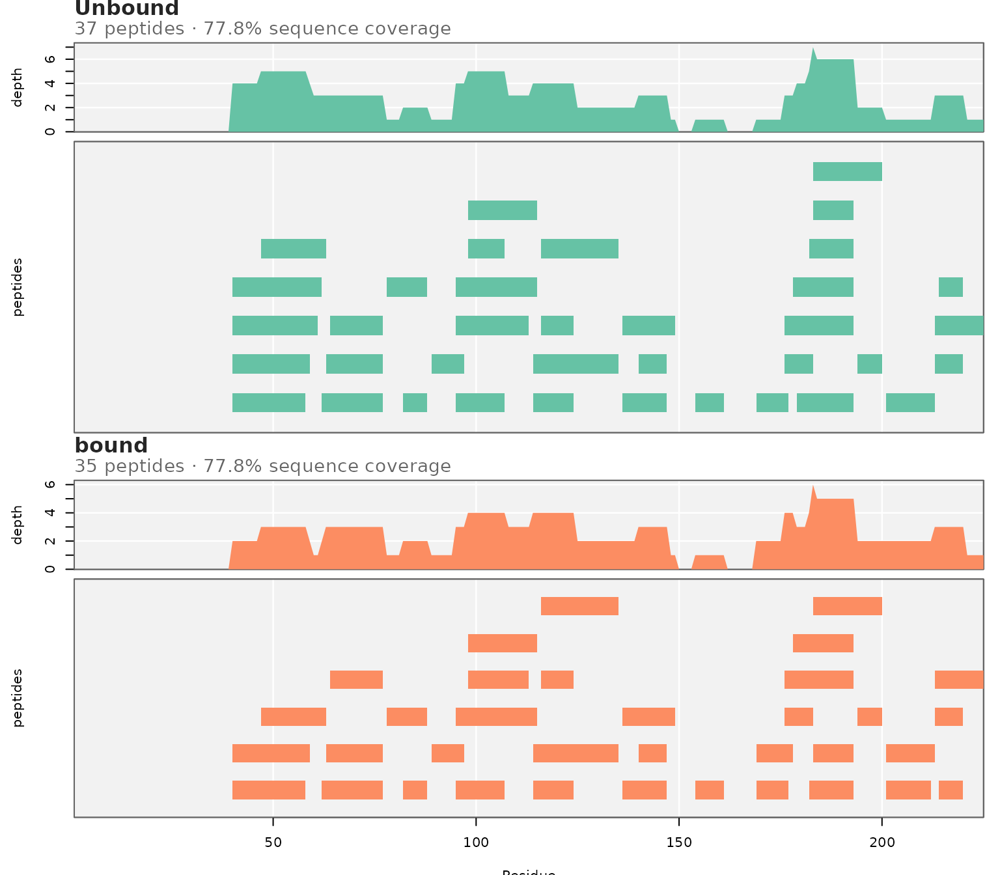
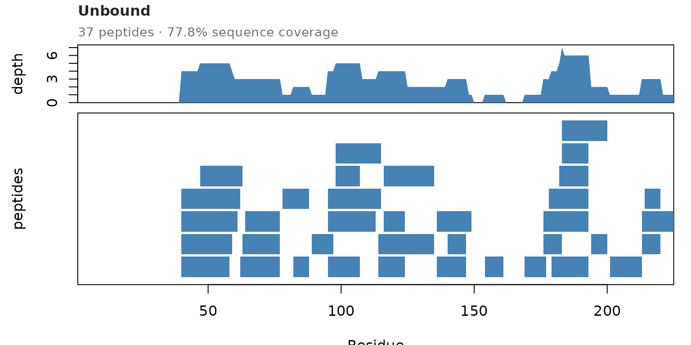

# Data Quality: Coverage, Redundancy, and Back-Exchange

Check the data before comparing states. States can only be compared
where both were measured well.

``` r

library(HDXBoxeR)
file_nm <- system.file("extdata", "All_results_table.csv", package = "HDXBoxeR")
```

## Summary tables

[`general_info()`](https://mkajano.github.io/HDXBoxeR/reference/general_info.md)
gives, per state, the number of peptides, sequence coverage, average
peptide length, and redundancy (how many peptides cover an average
residue):

``` r

general_info(file_nm)
#>         Protein.State                      Timepoints # replicates # peptides
#> Unbound       Unbound 3.00s 60.00s 1800.00s 72000.00s            3         37
#> bound           bound 3.00s 60.00s 1800.00s 72000.00s            3         34
#>         peptide coverage % <Peptide Length> <Redundancy>
#> Unbound              94.09            13.86         2.93
#> bound                94.09            13.29         2.58
```

Low coverage means part of the sequence was not measured. No significant
difference there means “not measured”, not “no change”. Low redundancy
means a residue is covered by few peptides, so one bad peptide is not
cross-checked.

[`backHX_calculations()`](https://mkajano.github.io/HDXBoxeR/reference/backHX_calculations.md)
gives the back-exchange per state. It uses the undeuterated (`0s`) and
fully deuterated (`FD`) controls, and the measured centroids (m/z x
charge):

``` r

backHX_calculations(file_nm)
#>         <BackHX> BackHX Range From    To
#> Unbound    27.01              1.31 51.48
#> bound      35.44             11.73 99.88
#> attr(,"method")
#> [1] "measured centroid (Exp Cent) x Charge: 1 - (m_FD - m_0s)/N/Dfact"
```

Very different back-exchange between states can bias the comparison.

## Peptide coverage map

[`plot_peptide_coverage_map()`](https://mkajano.github.io/HDXBoxeR/reference/plot_peptide_coverage_map.md)
shows where the peptides are: redundancy on top, the peptide map below,
one panel per state.

``` r

plot_peptide_coverage_map(file_nm)
```



Gaps are regions without data. A gap in one state but not the other is
worth noting before comparing those regions.

The look of the plot can be changed:

``` r

plot_peptide_coverage_map(file_nm, states = "Unbound", palette = "steelblue",
                          bg = "white", show_grid = FALSE, block_height = 0.9)
```



- `palette`: one color, or an RColorBrewer palette name.
- `bg`, `grid_col`, `show_grid`: background and grid lines.
- `row_gap`: space between peptides in one row.
- `block_height`, `block_border`: peptide block size and outline.

## Peptide checks

[`peptide_qc()`](https://mkajano.github.io/HDXBoxeR/reference/peptide_qc.md)
flags peptides with missing controls, uptake of 0 at every time point,
negative uptake, or odd FD values. It does not remove anything.

``` r

qc <- peptide_qc(file_nm)
qc[qc$issues != "", c("Protein.State", "Start", "End", "Sequence", "issues")]
#>    Protein.State Start End     Sequence
#> 27         bound   182 193 IWNKTASDQATT
#> 65       Unbound   182 193 IWNKTASDQATT
#>                                                             issues
#> 27 no undeuterated control; uptake 0 at every time; FD uptake <= 0
#> 65 no undeuterated control; uptake 0 at every time; FD uptake <= 0
```

In this example, peptide 182-193 has no undeuterated control, so
HDXExaminer reports its uptake as 0.

## How this connects to the rest of the package

| Question | Use |
|----|----|
| Summary table for a paper (Masson et al. 2019) | [`hdx_summary_table()`](https://mkajano.github.io/HDXBoxeR/reference/hdx_summary_table.md) |
| Everything in one HTML report | [`render_report()`](https://mkajano.github.io/HDXBoxeR/reference/render_report.md) |
| Correct for back-exchange | `output_tp(percent = "FD")` ([`vignette("input_formats")`](https://mkajano.github.io/HDXBoxeR/articles/input_formats.md)) |
| States with different peptide maps | [`compare_states_unmatched()`](https://mkajano.github.io/HDXBoxeR/reference/compare_states_unmatched.md) and its `coverage` table ([`vignette("multistate")`](https://mkajano.github.io/HDXBoxeR/articles/multistate.md)) |
| Residues covered by several peptides | [`residue_regions()`](https://mkajano.github.io/HDXBoxeR/reference/residue_regions.md) uses this redundancy ([`vignette("multistate")`](https://mkajano.github.io/HDXBoxeR/articles/multistate.md)) |
