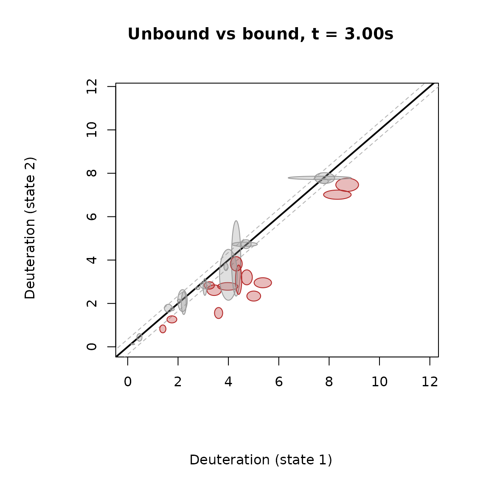
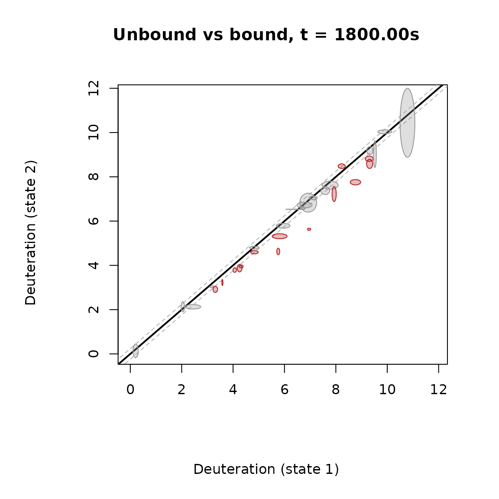
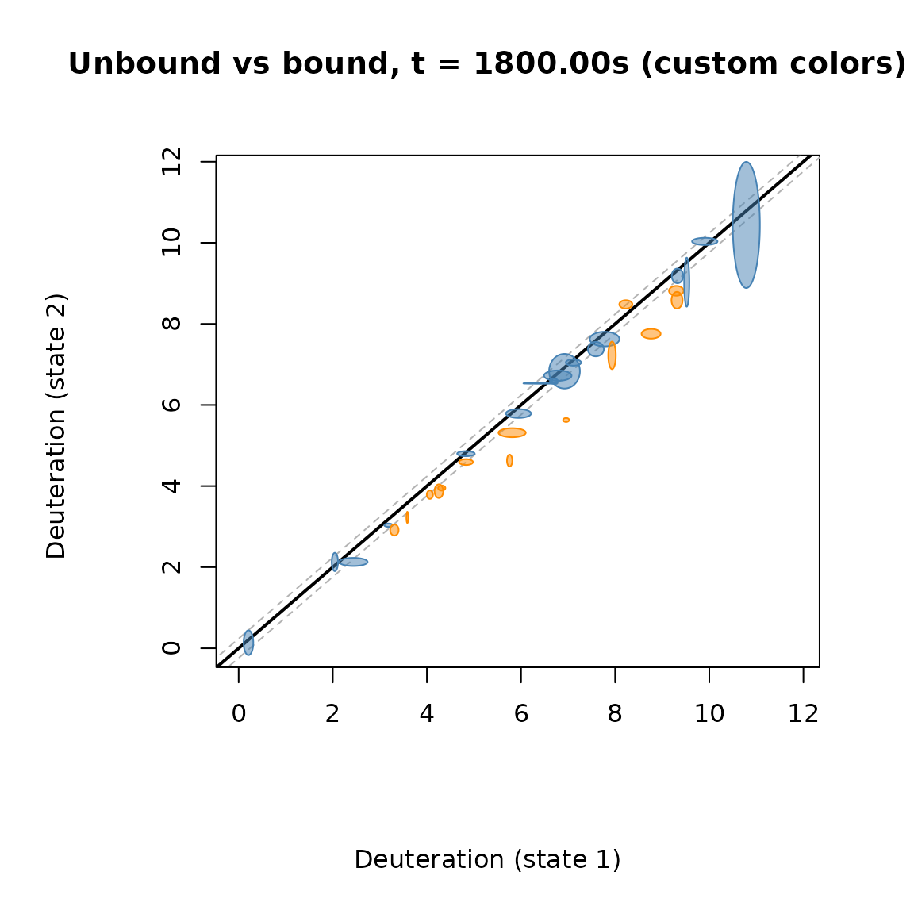
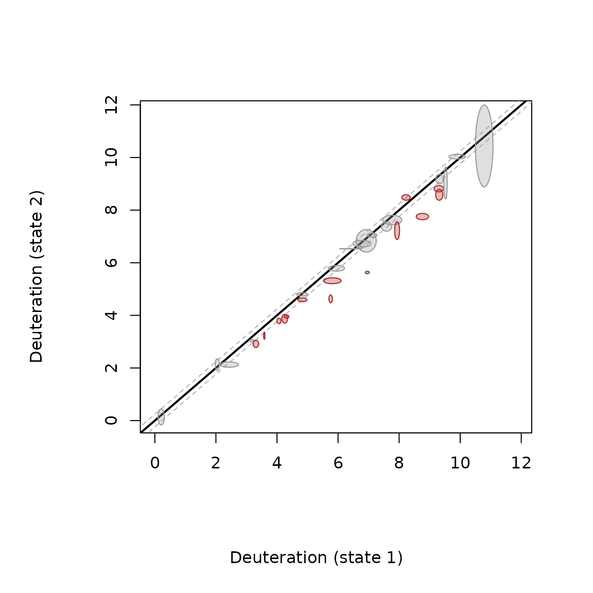

# Fissure Vent Plots

The fissure vent plot compares two protein states peptide by peptide. It
uses the same significance test as the rest of the package (Hageman &
Weis, Anal. Chem. 2019, 91, 8008-8016). The difference from a volcano
plot is that the deuteration of both states stays on the plot.

## How to read it

- x axis: deuteration of state 1. y axis: deuteration of state 2.
- The black diagonal (y = x) means no change between the states.
- The dashed grey lines are the critical interval (CI). It is calculated
  from the standard deviations of all peptides at that time point
  ([`CI_2pts()`](https://mkajano.github.io/HDXBoxeR/reference/CI_2pts.md)).
- Each peptide is an ellipse. The ellipse comes from the Welch t-test of
  that peptide. If the ellipse touches the diagonal, the peptide’s
  p-value is above the cutoff.
- A peptide is significant (colored) when it is outside the grey lines
  **and** its ellipse does not touch the diagonal.

The size of the ellipse shows how precise the replicates are. A small
ellipse means the replicates agree well.

## Example

``` r

library(HDXBoxeR)
file_nm <- system.file("extdata", "All_results_table.csv", package = "HDXBoxeR")
a <- output_tp(file_nm)
#> Protein.States used: Unbound bound
#> Deut.times used: 3.00s 60.00s 1800.00s 72000.00s
#> 29 peptide row(s) dropped: 29 not measured in every state, 0 with fewer than 2 replicate value(s)
#> Number of replicates used: Unbound=3 bound=3
#> no csv file written
```

Keep the figure square (`fig.width = fig.height`), so the diagonal stays
at 45 degrees.

``` r

plot_fissure_vent(df = a, times = "3.00s", alpha = 0.01, pvalue = 0.01,
                  state1 = "Unbound", state2 = "bound")
#> time 3.00s: CI = 0.350
#>   (1 peptide(s) skipped: NA average or ellipse, e.g. identical-valued replicates)
title(main = "Unbound vs bound, t = 3.00s")
```



Most peptides sit on the diagonal: at 3 s the states hardly differ. The
colored peptides are above the diagonal and their ellipses have cleared
it.

A later time point:

``` r

plot_fissure_vent(df = a, times = "1800.00s", alpha = 0.01, pvalue = 0.01,
                  state1 = "Unbound", state2 = "bound")
#> time 1800.00s: CI = 0.239
#>   (1 peptide(s) skipped: NA average or ellipse, e.g. identical-valued replicates)
title(main = "Unbound vs bound, t = 1800.00s")
```



Colors and transparency can be changed with `sig_col`, `nonsig_col`, and
`fill_alpha`:

``` r

plot_fissure_vent(df = a, times = "1800.00s", alpha = 0.01, pvalue = 0.01,
                  state1 = "Unbound", state2 = "bound",
                  sig_col = "darkorange", nonsig_col = "steelblue", fill_alpha = 0.5)
#> time 1800.00s: CI = 0.239
#>   (1 peptide(s) skipped: NA average or ellipse, e.g. identical-valued replicates)
title(main = "Unbound vs bound, t = 1800.00s (custom colors)")
```



The function also returns the numbers behind the plot:

``` r

res <- plot_fissure_vent(df = a, times = "1800.00s", state1 = "Unbound", state2 = "bound")
#> time 1800.00s: CI = 0.239
```



    #>   (1 peptide(s) skipped: NA average or ellipse, e.g. identical-valued replicates)
    head(res[res$is_sig, c("Start", "End", "Sequence", "delta", "p_value", "ci")])
    #>    Start End              Sequence      delta      p_value        ci
    #> 3     47  63     VVPGPAEHPLQYNYTFW -1.3283333 3.565653e-07 0.2392609
    #> 4     62  77      FWYSRRTPGRPTSSQS -0.4833333 4.094323e-04 0.2392609
    #> 5     63  77       WYSRRTPGRPTSSQS  0.2540000 2.730316e-03 0.2392609
    #> 8     82  88               IKQIGTF -0.2750000 7.527130e-04 0.2392609
    #> 9     89  97             ASVEQFWRF -1.1290000 6.604370e-05 0.2392609
    #> 11    95 115 WRFYSHMVRPGDLTGHSDFHL -0.7106667 2.100848e-03 0.2392609

## Useful options

- `p_adjust = "BH"`: corrects the p-values for multiple testing.
- `output_tp(..., percent = "per_residue")`: uptake per residue, so
  peptide length does not affect the result.
- `sd_source = "CI"`: the older, wider critical interval.

## Good to know

- Only the extent of the ellipse across the diagonal is a confidence
  interval. Its width and height alone are not.
- A peptide with identical replicates in both states cannot be tested.
  It is skipped, and a message says so.

## How this connects to the rest of the package

All of these use the same significance test; they differ in what they
show.

| Question | Use |
|----|----|
| The classic difference vs p-value picture | [`plots_vol_tp()`](https://mkajano.github.io/HDXBoxeR/reference/plots_vol_tp.md) |
| The list of significant peptides | [`diff_peptides_prep()`](https://mkajano.github.io/HDXBoxeR/reference/diff_peptides_prep.md), [`hdx_results_table()`](https://mkajano.github.io/HDXBoxeR/reference/hdx_results_table.md) |
| Both states’ uptake, with uncertainty, peptide by peptide | [`plot_fissure_vent()`](https://mkajano.github.io/HDXBoxeR/reference/plot_fissure_vent.md) (this vignette) |
| The same, interactive and linked to other plots | [`interactive_fissure_vent()`](https://mkajano.github.io/HDXBoxeR/reference/interactive_fissure_vent.md) ([`vignette("interactive_explorer")`](https://mkajano.github.io/HDXBoxeR/articles/interactive_explorer.md)) |
| More than two states | [`compare_states_tp()`](https://mkajano.github.io/HDXBoxeR/reference/compare_states_tp.md) ([`vignette("multistate")`](https://mkajano.github.io/HDXBoxeR/articles/multistate.md)) |
| A whole region or time course | [`compare_regions()`](https://mkajano.github.io/HDXBoxeR/reference/compare_regions.md), [`compare_timecourse()`](https://mkajano.github.io/HDXBoxeR/reference/compare_timecourse.md) ([`vignette("multistate")`](https://mkajano.github.io/HDXBoxeR/articles/multistate.md)) |
| Single residues | [`residue_deconvolution()`](https://mkajano.github.io/HDXBoxeR/reference/residue_deconvolution.md), [`residue_level_average()`](https://mkajano.github.io/HDXBoxeR/reference/residue_level_average.md), [`residue_regions()`](https://mkajano.github.io/HDXBoxeR/reference/residue_regions.md) |
