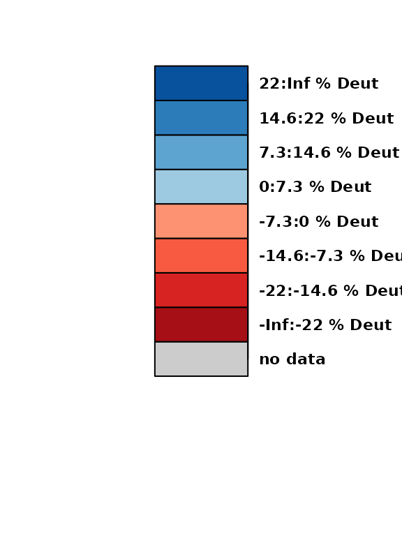

# Mapping HDX Data onto a 3D Structure

[`plot_hdx_structure()`](https://mkajano.github.io/HDXBoxeR/reference/plot_hdx_structure.md)
colors a protein structure by HDX data, directly in R. It shows an
interactive 3D view that can be rotated, saved, or put into a report. To
color structures in PyMOL instead, use the `pymol_script_*()` functions
(see
[`vignette("HDXBoxeR")`](https://mkajano.github.io/HDXBoxeR/articles/HDXBoxeR.md)).

The function needs the bio3d and NGLVieweR packages. They are optional
and are not installed with HDXBoxeR.

## What is colored

The input is per-residue data from
[`residue_level_average()`](https://mkajano.github.io/HDXBoxeR/reference/residue_level_average.md)
or
[`residue_deconvolution()`](https://mkajano.github.io/HDXBoxeR/reference/residue_deconvolution.md).
For one time point, each residue is colored by the difference
`state2 - state1`. The colors are the same red/blue scale as the heat
maps. Residues without data are grey.

## Example

``` r

library(HDXBoxeR)
file_nm <- system.file("extdata", "All_results_table.csv", package = "HDXBoxeR")
a <- output_tp(file_nm, percent = TRUE)
#> Protein.States used: Unbound bound
#> Deut.times used: 3.00s 60.00s 1800.00s 72000.00s
#> 29 peptide row(s) dropped: 29 not measured in every state, 0 with fewer than 2 replicate value(s)
#> Number of replicates used: Unbound=3 bound=3
#> no csv file written
res <- residue_level_average(a, protein_length = 225)
```

The structure below is **not** the protein of the example data. It is
lysozyme (`1HEL`), a small structure that comes with bio3d, used only to
show how the function works. Use the PDB of your own protein.

``` r

pdb_demo <- system.file("examples", "1hel.pdb", package = "bio3d")
plot_hdx_structure(res, pdb = pdb_demo, state1 = "Unbound", state2 = "bound",
                   times = "1800.00s", chain = "A")
```

The legend is drawn separately with
[`plot_hdx_structure_legend()`](https://mkajano.github.io/HDXBoxeR/reference/plot_hdx_structure_legend.md),
using the same `ranges`:

``` r

res_1800 <- res[res$Deut.Time == "1800.00s", ]
delta <- rowMeans(res_1800[, grep("^bound", colnames(res_1800))], na.rm = TRUE) -
  rowMeans(res_1800[, grep("^Unbound", colnames(res_1800))], na.rm = TRUE)
step <- max(abs(delta), na.rm = TRUE) / 3
plot_hdx_structure_legend(c(-Inf, -3*step, -2*step, -step, 0, step, 2*step, 3*step, Inf),
                          unit_label = "% Deut")
```



## Residue numbering

If the HDX numbering and the PDB numbering differ (for example because
of a tag), use `resno_offset`. It is added to every residue number
before matching the PDB. The same argument exists in the
`pymol_script_*()` functions.

## Good to know

- Residues are colored by the size of the difference, not by
  significance.
- One time point and one pair of states per call.

## How this connects to the rest of the package

| Question | Use |
|----|----|
| Per-residue values to color | [`residue_level_average()`](https://mkajano.github.io/HDXBoxeR/reference/residue_level_average.md), [`residue_deconvolution()`](https://mkajano.github.io/HDXBoxeR/reference/residue_deconvolution.md) ([`vignette("HDXBoxeR")`](https://mkajano.github.io/HDXBoxeR/articles/HDXBoxeR.md)) |
| Color only significant residues or peptides | [`pymol_script_significant_residue()`](https://mkajano.github.io/HDXBoxeR/reference/pymol_script_significant_residue.md), [`pymol_script_significant_peptide()`](https://mkajano.github.io/HDXBoxeR/reference/pymol_script_significant_peptide.md) |
| Color by average uptake | [`pymol_script_average_residue()`](https://mkajano.github.io/HDXBoxeR/reference/pymol_script_average_residue.md) |
| Regions that changed, to highlight | [`residue_regions()`](https://mkajano.github.io/HDXBoxeR/reference/residue_regions.md) ([`vignette("multistate")`](https://mkajano.github.io/HDXBoxeR/articles/multistate.md)) |
| Peptide-level view | [`plot_fissure_vent()`](https://mkajano.github.io/HDXBoxeR/reference/plot_fissure_vent.md) ([`vignette("fissure_vent")`](https://mkajano.github.io/HDXBoxeR/articles/fissure_vent.md)) |
