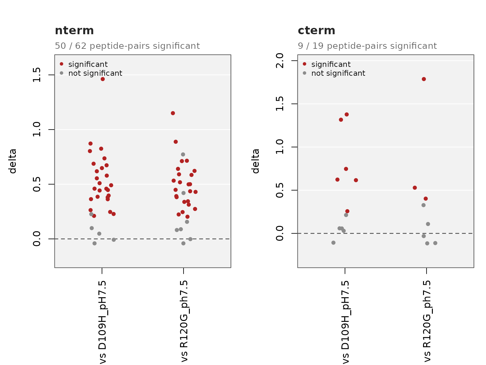
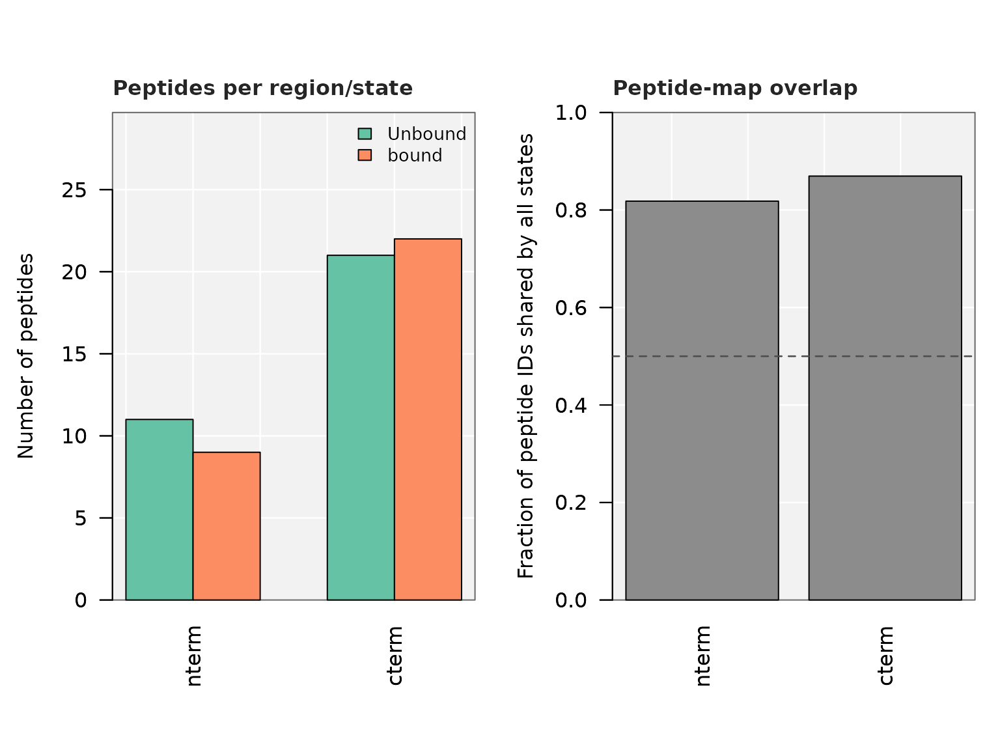
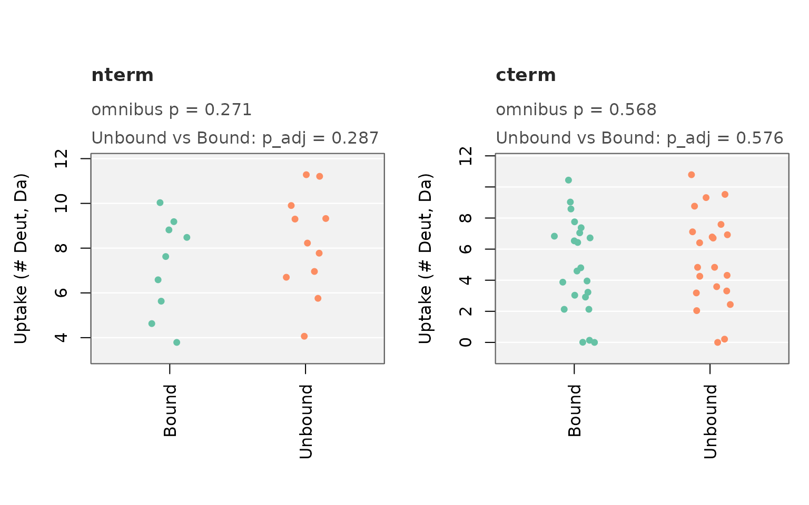
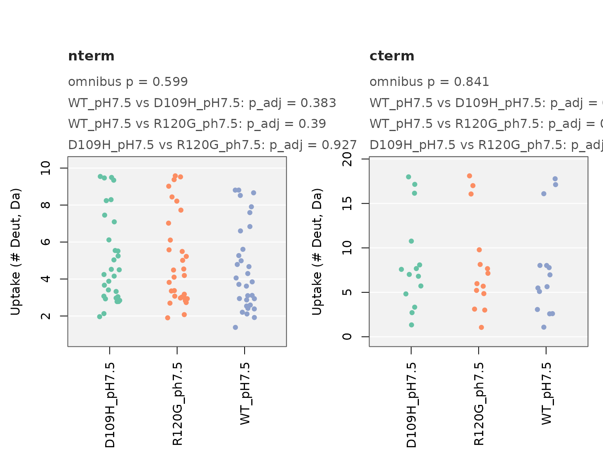

# Comparing Three or More States, and Whole Regions

This vignette shows how to compare more than two states, whole regions,
and whole time courses. For data checks, see
[`vignette("data_quality")`](https://mkajano.github.io/HDXBoxeR/articles/data_quality.md).

## The significance rule

All functions use the same rule (Hageman & Weis, Anal. Chem. 2019): a
peptide differs between two states when its Welch t-test p-value is
below `pvalue` **and** the difference is larger than the critical
interval (CI).

- `p_adjust = "BH"` corrects the p-values for multiple testing.
- `percent = "per_residue"` divides uptake by the number of exchangeable
  residues, so peptide length does not affect the result.

## Which function for which question

| Function | Question |
|----|----|
| [`compare_states_tp()`](https://mkajano.github.io/HDXBoxeR/reference/compare_states_tp.md) | Does this peptide differ between states? (3+ states) |
| [`compare_regions()`](https://mkajano.github.io/HDXBoxeR/reference/compare_regions.md) | Does this region differ between states? |
| [`compare_states_unmatched()`](https://mkajano.github.io/HDXBoxeR/reference/compare_states_unmatched.md) | Does this region differ, when the states have different peptides? |
| [`compare_timecourse()`](https://mkajano.github.io/HDXBoxeR/reference/compare_timecourse.md) | Does this peptide differ over the whole time course? |
| [`residue_regions()`](https://mkajano.github.io/HDXBoxeR/reference/residue_regions.md) | Which stretches of residues changed? |

For two states at one time point,
[`plot_fissure_vent()`](https://mkajano.github.io/HDXBoxeR/reference/plot_fissure_vent.md)
and
[`diff_peptides_prep()`](https://mkajano.github.io/HDXBoxeR/reference/diff_peptides_prep.md)
are the main tools.

## `compare_states_tp()`: peptides, three or more states

``` r

library(HDXBoxeR)
file_nm <- system.file("extdata", "All_results_table.csv", package = "HDXBoxeR")
file_3state <- system.file("extdata", "three_states.csv", package = "HDXBoxeR")
```

`three_states.csv` has a wild-type protein and two point mutants (D109H,
R120G), with 3-4 replicates (Woods et al. 2025, PNAS).

``` r

res <- compare_states_tp(file_3state, times = "1800.00s")
#> 22 peptide row(s) dropped: 22 not measured in every state, 0 with fewer than 2 replicate value(s)
#> Number of replicates used: WT_pH7.5=4 D109H_pH7.5=4 R120G_ph7.5=4
#> no csv file written
#> 10 peptide row(s) dropped: 10 not measured in every state, 0 with fewer than 2 replicate value(s)
#> Number of replicates used: WT_pH7.5=4 D109H_pH7.5=4
#> no csv file written
#> 14 peptide row(s) dropped: 14 not measured in every state, 0 with fewer than 2 replicate value(s)
#> Number of replicates used: WT_pH7.5=4 R120G_ph7.5=4
#> no csv file written
#> 20 peptide row(s) dropped: 20 not measured in every state, 0 with fewer than 2 replicate value(s)
#> Number of replicates used: D109H_pH7.5=4 R120G_ph7.5=4
#> no csv file written
head(res)
#>                        peptide_id Start End                Sequence   state1
#> 1                1_9_z2_MDIAIHHPW     1   9               MDIAIHHPW WT_pH7.5
#> 2           1_13_z3_MDIAIHHPWIRRP     1  13           MDIAIHHPWIRRP WT_pH7.5
#> 3 1_23_z3_MDIAIHHPWIRRPFFPFHSPSRL     1  23 MDIAIHHPWIRRPFFPFHSPSRL WT_pH7.5
#> 4 1_23_z4_MDIAIHHPWIRRPFFPFHSPSRL     1  23 MDIAIHHPWIRRPFFPFHSPSRL WT_pH7.5
#> 5 1_23_z5_MDIAIHHPWIRRPFFPFHSPSRL     1  23 MDIAIHHPWIRRPFFPFHSPSRL WT_pH7.5
#> 6  2_23_z4_DIAIHHPWIRRPFFPFHSPSRL     2  23  DIAIHHPWIRRPFFPFHSPSRL WT_pH7.5
#>        state2   delta      p_value        ci    p_omnibus        p_adj
#> 1 D109H_pH7.5 0.09850 7.793244e-03 0.1860082 1.063243e-02 7.793244e-03
#> 2 D109H_pH7.5 0.24650 9.561999e-04 0.1860082 1.420587e-03 9.561999e-04
#> 3 D109H_pH7.5 0.73650 2.157453e-05 0.1860082 4.837629e-05 2.157453e-05
#> 4 D109H_pH7.5 0.68750 9.520933e-04 0.1860082 1.254377e-03 9.520933e-04
#> 5 D109H_pH7.5 0.80325 1.477489e-04 0.1860082 2.465141e-05 1.477489e-04
#> 6 D109H_pH7.5 0.82500 5.675467e-04 0.1860082 1.812711e-04 5.675467e-04
#>   p_omnibus_adj is_sig
#> 1  1.063243e-02  FALSE
#> 2  1.420587e-03   TRUE
#> 3  4.837629e-05   TRUE
#> 4  1.254377e-03   TRUE
#> 5  2.465141e-05   TRUE
#> 6  1.812711e-04   TRUE
```

Each row is one peptide and one pair of states. `p_omnibus` is a Welch
ANOVA across all states. It is given for information; `is_sig` uses the
rule above for each pair.

Compare every state to one reference only:

``` r

res_ref <- compare_states_tp(file_3state, times = "1800.00s", reference = "WT_pH7.5")
#> 22 peptide row(s) dropped: 22 not measured in every state, 0 with fewer than 2 replicate value(s)
#> Number of replicates used: WT_pH7.5=4 D109H_pH7.5=4 R120G_ph7.5=4
#> no csv file written
#> 10 peptide row(s) dropped: 10 not measured in every state, 0 with fewer than 2 replicate value(s)
#> Number of replicates used: WT_pH7.5=4 D109H_pH7.5=4
#> no csv file written
#> 14 peptide row(s) dropped: 14 not measured in every state, 0 with fewer than 2 replicate value(s)
#> Number of replicates used: WT_pH7.5=4 R120G_ph7.5=4
#> no csv file written
unique(res_ref[, c("state1", "state2")])
#>      state1      state2
#> 1  WT_pH7.5 D109H_pH7.5
#> 46 WT_pH7.5 R120G_ph7.5
```

Peptides that cover a mutation have a different sequence in the mutant.
`by = "position"` matches peptides by position, so these peptides are
compared too:

``` r

res_pos <- compare_states_tp(file_3state, times = "1800.00s", reference = "WT_pH7.5", by = "position")
#> Number of replicates used: WT_pH7.5=4 D109H_pH7.5=4 R120G_ph7.5=4
#> no csv file written
#> Number of replicates used: WT_pH7.5=4 D109H_pH7.5=4
#> no csv file written
#> Number of replicates used: WT_pH7.5=4 R120G_ph7.5=4
#> no csv file written
c(by_sequence = nrow(res_ref), by_position = nrow(res_pos))
#> by_sequence by_position 
#>          88         100
```

Split by regions:

``` r

res_regions <- compare_states_tp(file_3state, times = "1800.00s", reference = "WT_pH7.5",
                                 regions = list(nterm = c(1, 90), cterm = c(91, 175)))
#> 22 peptide row(s) dropped: 22 not measured in every state, 0 with fewer than 2 replicate value(s)
#> Number of replicates used: WT_pH7.5=4 D109H_pH7.5=4 R120G_ph7.5=4
#> no csv file written
#> 10 peptide row(s) dropped: 10 not measured in every state, 0 with fewer than 2 replicate value(s)
#> Number of replicates used: WT_pH7.5=4 D109H_pH7.5=4
#> no csv file written
#> 14 peptide row(s) dropped: 14 not measured in every state, 0 with fewer than 2 replicate value(s)
#> Number of replicates used: WT_pH7.5=4 R120G_ph7.5=4
#> no csv file written
table(res_regions$region)
#> 
#> cterm nterm 
#>    19    62
```

``` r

plot_compare_states_tp(res_regions, plot_type = "jitter")
```



Every peptide is shown; significant ones are colored.
`plot_type = "box"` or `"violin"` adds a summary shape.

## `compare_regions()`: a whole region

[`compare_regions()`](https://mkajano.github.io/HDXBoxeR/reference/compare_regions.md)
tests whether the states differ in a region. Each peptide is its own
control: the model is `uptake ~ peptide + state` on the peptide
averages. For two states this is a paired t-test of the peptide
differences. The peptides must be found in every state.

``` r

reg <- compare_regions(file_nm, times = "1800.00s",
                       regions = list(nterm = c(1, 100), cterm = c(101, 225)))
reg$summary
#>   region Deut.Time n_peptides n_obs   F_state df_state df_resid    p_state
#> 1  nterm  1800.00s          9    54  4.012432        1        8 0.08012977
#> 2  cterm  1800.00s         20   120 17.078329        1       19 0.00056602
#>   p_state_adj p_state_x_peptide
#> 1  0.08012977      7.621526e-28
#> 2  0.00056602      2.886840e-24
reg$pairs
#>   region Deut.Time  state1 state2   estimate         se    p_value      p_adj
#> 1  nterm  1800.00s Unbound  bound -0.3596296 0.17953604 0.08012977 0.08012977
#> 2  cterm  1800.00s Unbound  bound -0.2543000 0.06153521 0.00056602 0.00056602
```

- `p_state`: do the states differ in this region?
- `p_state_x_peptide`: does the difference change from peptide to
  peptide? If yes, the effect is local - look at the single peptides.
- `estimate`: the average difference per peptide (state2 - state1).

Here cterm differs clearly (p = 0.0006). nterm is borderline (p = 0.08):
some of its peptides change and some do not.

All time points in one model, with a test for state x time:

``` r

compare_regions(file_nm, regions = list(nterm = c(1, 100), cterm = c(101, 225)),
                time_model = TRUE)$summary
#>   region Deut.Time n_peptides n_obs  F_state df_state df_resid      p_state
#> 1  nterm       all          9   216 27.24280        1       35 8.257467e-06
#> 2  cterm       all         20   480 49.85344        1       79 5.718792e-10
#>    p_state_adj p_state_x_peptide p_state_x_time
#> 1 8.257467e-06      1.578649e-20      0.0277035
#> 2 5.718792e-10      1.544159e-51      0.3810325
```

## `compare_states_unmatched()`: different peptides in the states

Use this function when the states do not share the same peptides. All
peptides in a region are pooled per state, and the states are compared.
`regions` is required.

``` r

res_unmatched <- compare_states_unmatched(file_nm, times = "1800.00s",
                                          regions = list(nterm = c(1, 100), cterm = c(101, 225)))
res_unmatched$summary
#>   region  state1 state2 n_peptides_tested n_peptides_significant
#> 1  nterm Unbound  bound                 9                      5
#> 2  cterm Unbound  bound                19                      6
#>   frac_peptides_significant n1 n2   shift_hl ci_low ci_high   p_value p_omnibus
#> 1                 0.5555556 11  9 -1.0886667     NA      NA 0.2874954 0.2706274
#> 2                 0.3157895 21 22 -0.3056667     NA      NA 0.5762709 0.5680073
#>       p_adj
#> 1 0.2874954
#> 2 0.5762709
res_unmatched$coverage
#>   region   state n_peptides mean_length frac_shared_all_states
#> 1  nterm Unbound         11    15.72727              0.8181818
#> 2  nterm   bound          9    14.22222              0.8181818
#> 3  cterm Unbound         21    12.33333              0.8695652
#> 4  cterm   bound         22    12.09091              0.8695652
```

Read the first columns first: `frac_peptides_significant` is the
fraction of the shared peptides that differ by the rule above. The
pooled test after it is only approximate.

Here the pooled test is not significant (p = 0.29 and 0.58), but 5/9
nterm peptides and 6/19 cterm peptides differ. A non-significant pooled
result does **not** mean nothing changed.

`frac_shared_all_states` in `coverage` is the fraction of peptides found
in every state. If it is low, a difference can come from different
peptides rather than different exchange.

``` r

plot_coverage_diagnostics(res_unmatched)
```



``` r

plot_compare_states_unmatched(res_unmatched, plot_type = "jitter",
                              state_labels = c(Unbound = "Unbound", bound = "Bound"))
```



More than two states work the same way, and the mutant peptides are
included:

``` r

res3_unmatched <- compare_states_unmatched(file_3state, times = "1800.00s",
                                           regions = list(nterm = c(1, 90), cterm = c(91, 175)))
plot_compare_states_unmatched(res3_unmatched, plot_type = "jitter")
```



Options:

``` r

## values: uptake in Da (default), percent, or uptake per exchangeable residue
compare_states_unmatched(file_nm, times = "1800.00s", regions = list(nterm = c(1, 100)), value = "frac_deut")
## methods: "peptide" (default), "resample" (permutation p-values and bootstrap CI),
## "classic" (every replicate pooled; only to reproduce old analyses)
compare_states_unmatched(file_nm, times = "1800.00s", regions = list(nterm = c(1, 100)),
                         method = "resample", seed = 1)
```

## `compare_timecourse()`: the whole time course

[`compare_timecourse()`](https://mkajano.github.io/HDXBoxeR/reference/compare_timecourse.md)
judges each peptide on all time points together. It gives the summed
difference over time with its own CI, and the number of time points
where the peptide is significant.

``` r

tc <- compare_timecourse(file_nm, "Unbound", "bound")
head(tc[order(tc$p_value), c("Start", "End", "summed_delta", "p_value", "ci_sum",
                             "sig_summed", "n_timepoints_sig")])
#>    Start End summed_delta      p_value    ci_sum sig_summed n_timepoints_sig
#> 12    98 115    -5.240667 3.667852e-14 0.3434353       TRUE                4
#> 11    95 115    -4.834667 1.280392e-11 0.3434353       TRUE                4
#> 17   136 147    -3.690667 1.398322e-11 0.3434353       TRUE                3
#> 9     89  97    -3.061000 1.509051e-11 0.3434353       TRUE                3
#> 21   169 177    -1.020333 1.900268e-11 0.3434353       TRUE                2
#> 7     78  88    -1.439000 1.945552e-11 0.3434353       TRUE                1
```

Robot plots can show only peptides significant at two or more time
points: `robot_plot_All(..., min_timepoints = 2)`.

## `residue_regions()`: stretches of residues

[`residue_regions()`](https://mkajano.github.io/HDXBoxeR/reference/residue_regions.md)
finds stretches of residues that changed in the same direction. A
residue is included when at least `min_peptides` (default 2) significant
peptides cover it. The effect is given per exchangeable residue.

``` r

a_da <- output_tp(file_nm)
#> Protein.States used: Unbound bound
#> Deut.times used: 3.00s 60.00s 1800.00s 72000.00s
#> 29 peptide row(s) dropped: 29 not measured in every state, 0 with fewer than 2 replicate value(s)
#> Number of replicates used: Unbound=3 bound=3
#> no csv file written
rr <- residue_regions(a_da, state1 = "Unbound", state2 = "bound", times = "1800.00s")
rr
#>   direction region_start region_end n_residues n_peptides
#> 1 protected           62         63          2          2
#> 2 protected           95        124         30          6
#>   mean_per_residue_delta pooled_CI_Da
#> 1            -0.07548611    0.2392609
#> 2            -0.04715929    0.2392609
```

Check the regions against your own domains:

``` r

residue_regions_subset_summary(rr, regions = list(nterm = c(1, 100), cterm = c(101, 225)))
#>   subset n_residues n_residues_significant frac_significant
#> 1  nterm        100                      8            0.080
#> 2  cterm        125                     24            0.192
#>   n_regions_overlapping directions
#> 1                     2  protected
#> 2                     1  protected
```
